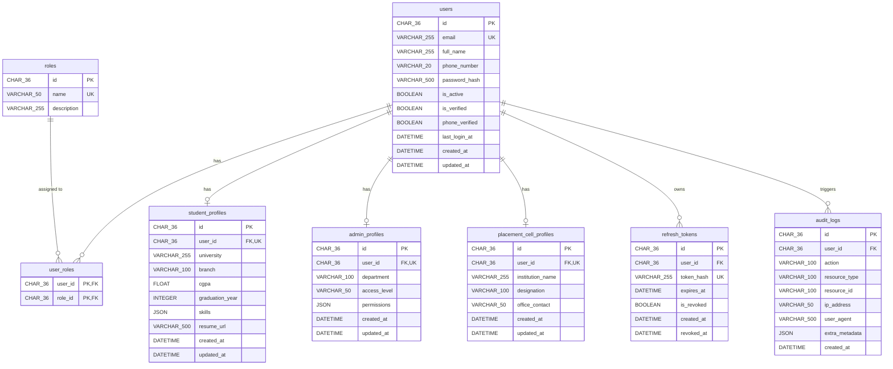

# NEXORA AI — Database Schema Specification
## Architecture, Entity Relationships, Constraints & Indexes

**Date:** 2026-11-19  
**Version:** 1.0 (Phase 2 Baseline)  
**ORM Framework:** SQLAlchemy 2.0 Async Declarative  
**Migration Engine:** Alembic  
**Target Engine:** PostgreSQL (Development fallback: SQLite Async via aiosqlite)  

---

## 1. Schema Diagram (Mermaid)

---

## 2. Table Definitions & Constraints

### 2.1 Table: `roles`
Stores recognized application roles.
- `id` (CHAR(36), PK): UUID identifier.
- `name` (VARCHAR(50), Unique, Not Null): Role identifier (`student`, `admin`, `placement_cell`, `recruiter`).
- `description` (VARCHAR(255), Nullable): Human-readable role explanation.

### 2.2 Table: `users`
Central identity record for all actors on the platform.
- `id` (CHAR(36), PK): Primary key UUID.
- `email` (VARCHAR(255), Unique, Not Null, Indexed): Lowercase trimmed email address.
- `full_name` (VARCHAR(255), Not Null): Full user display name.
- `phone_number` (VARCHAR(20), Nullable): E.164 phone string.
- `password_hash` (VARCHAR(500), Not Null): Argon2id hash format.
- `is_active` (BOOLEAN, Default True, Not Null): Account active status flag.
- `is_verified` (BOOLEAN, Default False, Not Null): Email verification indicator.
- `phone_verified` (BOOLEAN, Default False, Not Null): Phone verification indicator.
- `last_login_at` (DATETIME, Nullable): Timestamp of most recent authentication.
- `created_at` (DATETIME, Default UTC Now, Not Null): Account creation timestamp.
- `updated_at` (DATETIME, Default UTC Now, OnUpdate UTC Now, Not Null): Timestamp of last record update.

### 2.3 Table: `user_roles`
Composite association table facilitating many-to-many user role mapping.
- `user_id` (CHAR(36), PK, FK `users.id` ON DELETE CASCADE).
- `role_id` (CHAR(36), PK, FK `roles.id` ON DELETE CASCADE).

### 2.4 Table: `student_profiles`
1-to-1 profile extension specific to students.
- `id` (CHAR(36), PK): UUID identifier.
- `user_id` (CHAR(36), Unique, FK `users.id` ON DELETE CASCADE, Not Null): User reference.
- `university` (VARCHAR(255), Nullable): Institution name.
- `branch` (VARCHAR(100), Nullable): Engineering or science specialization.
- `cgpa` (FLOAT, Nullable): Cumulative Grade Point Average.
- `graduation_year` (INTEGER, Nullable): Year of graduation.
- `skills` (JSON, Default `[]`): Array of verified and self-reported skill tags.
- `resume_url` (VARCHAR(500), Nullable): Reference to uploaded resume artifact.
- `created_at`, `updated_at` (DATETIME).

### 2.5 Table: `admin_profiles`
1-to-1 profile extension for administrative personnel.
- `id` (CHAR(36), PK): UUID identifier.
- `user_id` (CHAR(36), Unique, FK `users.id` ON DELETE CASCADE, Not Null): User reference.
- `department` (VARCHAR(100), Nullable): Internal division or unit.
- `access_level` (VARCHAR(50), Default `'standard'`, Not Null): Tier level (`superadmin`, `standard`).
- `permissions` (JSON, Default `{}`): Granular feature access map.
- `created_at`, `updated_at` (DATETIME).

### 2.6 Table: `placement_cell_profiles`
1-to-1 profile extension for placement officers.
- `id` (CHAR(36), PK): UUID identifier.
- `user_id` (CHAR(36), Unique, FK `users.id` ON DELETE CASCADE, Not Null): User reference.
- `institution_name` (VARCHAR(255), Nullable): Name of academic institution.
- `designation` (VARCHAR(100), Nullable): Office designation (e.g., Placement Director).
- `office_contact` (VARCHAR(50), Nullable): Campus office phone / extension.
- `created_at`, `updated_at` (DATETIME).

### 2.7 Table: `refresh_tokens`
Stateful token store tracking JWT refresh tokens for replay prevention and revocation.
- `id` (CHAR(36), PK): UUID identifier.
- `user_id` (CHAR(36), FK `users.id` ON DELETE CASCADE, Not Null, Indexed): Owning user.
- `token_hash` (VARCHAR(255), Unique, Not Null, Indexed): SHA-256 digest of raw token string.
- `expires_at` (DATETIME, Not Null): Token expiration deadline.
- `is_revoked` (BOOLEAN, Default False, Not Null, Indexed): Revocation status flag.
- `created_at` (DATETIME, Default UTC Now): Generation timestamp.
- `revoked_at` (DATETIME, Nullable): Invalidation timestamp.

### 2.8 Table: `audit_logs`
Tamper-evident security trail.
- `id` (CHAR(36), PK): UUID identifier.
- `user_id` (CHAR(36), FK `users.id` ON DELETE SET NULL, Nullable, Indexed): Actor user ID.
- `action` (VARCHAR(100), Not Null, Indexed): Event name (e.g., `user.registered`, `auth.login.success`).
- `resource_type` (VARCHAR(100), Nullable): Target resource (e.g., `user`, `student_profile`).
- `resource_id` (VARCHAR(100), Nullable): Identifier of affected entity.
- `ip_address` (VARCHAR(50), Nullable): Client IP address.
- `user_agent` (VARCHAR(500), Nullable): Request client agent header.
- `extra_metadata` (JSON, Default `{}`): Contextual metadata payload.
- `created_at` (DATETIME, Default UTC Now, Indexed): Event timestamp.

---

## 3. Database Indexes

| Table | Index Name | Columns | Purpose |
|---|---|---|---|
| `users` | `ix_users_email` | `email` (Unique) | Rapid user lookup on login / registration |
| `refresh_tokens` | `ix_refresh_tokens_token_hash` | `token_hash` (Unique) | Fast token validation during refresh flow |
| `refresh_tokens` | `ix_refresh_tokens_user_id` | `user_id` | User session enumeration and batch revocation |
| `refresh_tokens` | `ix_refresh_tokens_is_revoked` | `is_revoked` | Filter active vs revoked tokens |
| `audit_logs` | `ix_audit_logs_user_id` | `user_id` | Query audit events by user |
| `audit_logs` | `ix_audit_logs_action` | `action` | Filter events by action type |
| `audit_logs` | `ix_audit_logs_created_at` | `created_at` | Time-series filtering and retention cleanup |
