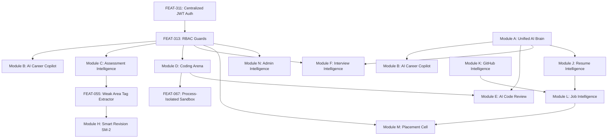

# NEXORA AI - Feature Dependency Map

---

## Detailed Component Dependencies

- **FEAT-001 (Central AI Provider Abstraction Interface):** Requires FEAT-311, FEAT-313; Integrates with BRAIN core service.
- **FEAT-002 (Student Context Aggregator):** Requires FEAT-311, FEAT-313; Integrates with BRAIN core service.
- **FEAT-003 (Deterministic Offline Fallback Engine):** Requires FEAT-311, FEAT-313; Integrates with BRAIN core service.
- **FEAT-004 (Token & Cost Telemetry Tracker):** Requires FEAT-311, FEAT-313; Integrates with BRAIN core service.
- **FEAT-005 (AI Prompt Safety & Sanitization Filter):** Requires FEAT-311, FEAT-313; Integrates with BRAIN core service.
- **FEAT-006 (AI Recommendation Explainability Engine):** Requires FEAT-311, FEAT-313; Integrates with BRAIN core service.
- **FEAT-007 (Context Window Optimization):** Requires FEAT-311, FEAT-313; Integrates with BRAIN core service.
- **FEAT-008 (Model Response Schema Validator):** Requires FEAT-311, FEAT-313; Integrates with BRAIN core service.
- **FEAT-009 (Personalized AI Persona Manager):** Requires FEAT-311, FEAT-313; Integrates with BRAIN core service.
- **FEAT-010 (Multi-turn Conversation Persistence):** Requires FEAT-311, FEAT-313; Integrates with BRAIN core service.
- **FEAT-011 (AI Latency & Timeout Guardian):** Requires FEAT-311, FEAT-313; Integrates with BRAIN core service.
- **FEAT-012 (Skill Gap Vector Matcher):** Requires FEAT-311, FEAT-313; Integrates with BRAIN core service.
- **FEAT-013 (Realtime AI Streaming Support):** Requires FEAT-311, FEAT-313; Integrates with BRAIN core service.
- **FEAT-014 (AI Output Confidence Score Estimator):** Requires FEAT-311, FEAT-313; Integrates with BRAIN core service.
- **FEAT-015 (Automated AI Feedback Logging):** Requires FEAT-311, FEAT-313; Integrates with BRAIN core service.
- **FEAT-016 (Career Readiness Index Calculator):** Requires FEAT-311, FEAT-313; Integrates with BRAIN core service.
- **FEAT-017 (AI Rate Limiter & Quota Gate):** Requires FEAT-311, FEAT-313; Integrates with BRAIN core service.
- **FEAT-018 (Multi-Language Explanation Translator):** Requires FEAT-311, FEAT-313; Integrates with BRAIN core service.
- **FEAT-019 (Weakness Remediation Plan Generator):** Requires FEAT-311, FEAT-313; Integrates with BRAIN core service.
- **FEAT-020 (AI Knowledge Graph Concept Linker):** Requires FEAT-311, FEAT-313; Integrates with BRAIN core service.
- **FEAT-021 (Personalized Career Path Selector):** Requires FEAT-311, FEAT-313; Integrates with COPILOT core service.
- **FEAT-022 (Dynamic 90-Day Placement Roadmap):** Requires FEAT-311, FEAT-313; Integrates with COPILOT core service.
- **FEAT-023 (Daily Sprints & Actionable Goals):** Requires FEAT-311, FEAT-313; Integrates with COPILOT core service.
- **FEAT-024 (Target Company Preparation Matrix):** Requires FEAT-311, FEAT-313; Integrates with COPILOT core service.
- **FEAT-025 (Skill Benchmark Against Industry Standards):** Requires FEAT-311, FEAT-313; Integrates with COPILOT core service.
- **FEAT-026 (Internship Readiness Evaluator):** Requires FEAT-311, FEAT-313; Integrates with COPILOT core service.
- **FEAT-027 (Weekly Progress Digest Generator):** Requires FEAT-311, FEAT-313; Integrates with COPILOT core service.
- **FEAT-028 (Study Habit & Velocity Tracker):** Requires FEAT-311, FEAT-313; Integrates with COPILOT core service.
- **FEAT-029 (Smart Project Recommendation Engine):** Requires FEAT-311, FEAT-313; Integrates with COPILOT core service.
- **FEAT-030 (Peer Rank & Cohort Comparison):** Requires FEAT-311, FEAT-313; Integrates with COPILOT core service.
- **FEAT-031 (Career Milestone Badge System):** Requires FEAT-311, FEAT-313; Integrates with COPILOT core service.
- **FEAT-032 (AI Mentor Direct Q&A Console):** Requires FEAT-311, FEAT-313; Integrates with COPILOT core service.
- **FEAT-033 (Resume-Driven Roadmap Adjustment):** Requires FEAT-311, FEAT-313; Integrates with COPILOT core service.
- **FEAT-034 (Interview Timeline Countdown):** Requires FEAT-311, FEAT-313; Integrates with COPILOT core service.
- **FEAT-035 (Burnout & Fatigue Warning Detector):** Requires FEAT-311, FEAT-313; Integrates with COPILOT core service.
- **FEAT-036 (Target Salary & Compensation Insights):** Requires FEAT-311, FEAT-313; Integrates with COPILOT core service.
- **FEAT-037 (Certification Recommendation Finder):** Requires FEAT-311, FEAT-313; Integrates with COPILOT core service.
- **FEAT-038 (Campus Placement Eligibility Checker):** Requires FEAT-311, FEAT-313; Integrates with COPILOT core service.
- **FEAT-039 (Daily Tech Trivia & Micro-Quiz):** Requires FEAT-311, FEAT-313; Integrates with COPILOT core service.
- **FEAT-040 (Study Group Matcher):** Requires FEAT-311, FEAT-313; Integrates with COPILOT core service.
- **FEAT-041 (Timed Assessment Engine Core):** Requires FEAT-311, FEAT-313; Integrates with ASSESS core service.
- **FEAT-042 (Auto-Save Answer State):** Requires FEAT-311, FEAT-313; Integrates with ASSESS core service.
- **FEAT-043 (Interrupted Attempt Recovery):** Requires FEAT-311, FEAT-313; Integrates with ASSESS core service.
- **FEAT-044 (Question Randomization & Shuffling):** Requires FEAT-311, FEAT-313; Integrates with ASSESS core service.
- **FEAT-045 (Negative Marking Evaluator):** Requires FEAT-311, FEAT-313; Integrates with ASSESS core service.
- **FEAT-046 (Question Flagging for Review):** Requires FEAT-311, FEAT-313; Integrates with ASSESS core service.
- **FEAT-047 (Sectional Time Limits & Switching):** Requires FEAT-311, FEAT-313; Integrates with ASSESS core service.
- **FEAT-048 (Comprehensive Diagnostic Scorecard):** Requires FEAT-311, FEAT-313; Integrates with ASSESS core service.
- **FEAT-049 (Detailed Solution & Explanation Viewer):** Requires FEAT-311, FEAT-313; Integrates with ASSESS core service.
- **FEAT-050 (Adaptive Difficulty Engine):** Requires FEAT-311, FEAT-313; Integrates with ASSESS core service.
- **FEAT-051 (Company-Specific Test Templates):** Requires FEAT-311, FEAT-313; Integrates with ASSESS core service.
- **FEAT-052 (Subject & Topic-Wise Practice Tests):** Requires FEAT-311, FEAT-313; Integrates with ASSESS core service.
- **FEAT-053 (Anti-Cheating Window Blur Detection):** Requires FEAT-311, FEAT-313; Integrates with ASSESS core service.
- **FEAT-054 (Historical Assessment Trends):** Requires FEAT-311, FEAT-313; Integrates with ASSESS core service.
- **FEAT-055 (Weak Area Tag Extractor):** Requires FEAT-311, FEAT-313; Integrates with ASSESS core service.
- **FEAT-056 (Leaderboard for Public Assessments):** Requires FEAT-311, FEAT-313; Integrates with ASSESS core service.
- **FEAT-057 (Question Report & Feedback System):** Requires FEAT-311, FEAT-313; Integrates with ASSESS core service.
- **FEAT-058 (Admin Question Bank CRUD):** Requires FEAT-311, FEAT-313; Integrates with ASSESS core service.
- **FEAT-059 (Bulk Question CSV/JSON Importer):** Requires FEAT-311, FEAT-313; Integrates with ASSESS core service.
- **FEAT-060 (Assessment Retake Policy Controller):** Requires FEAT-311, FEAT-313; Integrates with ASSESS core service.
- **FEAT-061 (Assessment Certificate Generator):** Requires FEAT-311, FEAT-313; Integrates with ASSESS core service.
- **FEAT-062 (Mock Drive Assessment Mode):** Requires FEAT-311, FEAT-313; Integrates with ASSESS core service.
- **FEAT-063 (Monaco-Based Online Code Editor):** Requires FEAT-311, FEAT-313; Integrates with CODING core service.
- **FEAT-064 (Multi-Language Runtime Support):** Requires FEAT-311, FEAT-313; Integrates with CODING core service.
- **FEAT-065 (Problem Catalog Browser):** Requires FEAT-311, FEAT-313; Integrates with CODING core service.
- **FEAT-066 (Company-Wise Problem Filtering):** Requires FEAT-311, FEAT-313; Integrates with CODING core service.
- **FEAT-067 (Public Test Case Execution):** Requires FEAT-311, FEAT-313; Integrates with CODING core service.
- **FEAT-068 (Hidden Test Case Evaluation):** Requires FEAT-311, FEAT-313; Integrates with CODING core service.
- **FEAT-069 (Process-Isolated Execution Sandbox):** Requires FEAT-311, FEAT-313; Integrates with CODING core service.
- **FEAT-070 (Strict Execution Timeouts):** Requires FEAT-311, FEAT-313; Integrates with CODING core service.
- **FEAT-071 (Memory Limit Ceilings):** Requires FEAT-311, FEAT-313; Integrates with CODING core service.
- **FEAT-072 (Sanitized Output & Error Formatter):** Requires FEAT-311, FEAT-313; Integrates with CODING core service.
- **FEAT-073 (Detailed Submission History):** Requires FEAT-311, FEAT-313; Integrates with CODING core service.
- **FEAT-074 (Coding Streak & Activity Tracker):** Requires FEAT-311, FEAT-313; Integrates with CODING core service.
- **FEAT-075 (Live Coding Contest Engine):** Requires FEAT-311, FEAT-313; Integrates with CODING core service.
- **FEAT-076 (Editorial Solution & Discussion Tab):** Requires FEAT-311, FEAT-313; Integrates with CODING core service.
- **FEAT-077 (Problem Custom Input Runner):** Requires FEAT-311, FEAT-313; Integrates with CODING core service.
- **FEAT-078 (Plagiarism & Similarity Detection Hook):** Requires FEAT-311, FEAT-313; Integrates with CODING core service.
- **FEAT-079 (Curated Problem Bank of 1000+ Problems):** Requires FEAT-311, FEAT-313; Integrates with CODING core service.
- **FEAT-080 (100+ Company Question Mappings):** Requires FEAT-311, FEAT-313; Integrates with CODING core service.
- **FEAT-081 (Submission Runtime Distribution Graph):** Requires FEAT-311, FEAT-313; Integrates with CODING core service.
- **FEAT-082 (Submission Memory Distribution Graph):** Requires FEAT-311, FEAT-313; Integrates with CODING core service.
- **FEAT-083 (Multi-File Project Playground):** Requires FEAT-311, FEAT-313; Integrates with CODING core service.
- **FEAT-084 (Bookmark & Solved Later List):** Requires FEAT-311, FEAT-313; Integrates with CODING core service.
- **FEAT-085 (Daily LeetCode/GFG Style Problem of the Day):** Requires FEAT-311, FEAT-313; Integrates with CODING core service.
- **FEAT-086 (Admin Coding Problem Authoring Portal):** Requires FEAT-311, FEAT-313; Integrates with CODING core service.
- **FEAT-087 (Static Code Quality Analyzer):** Requires FEAT-311, FEAT-313; Integrates with CODEREV core service.
- **FEAT-088 (Algorithmic Bug & Logic Error Spotter):** Requires FEAT-311, FEAT-313; Integrates with CODEREV core service.
- **FEAT-089 (Asymptotic Complexity Estimator):** Requires FEAT-311, FEAT-313; Integrates with CODEREV core service.
- **FEAT-090 (Code Optimization Recommender):** Requires FEAT-311, FEAT-313; Integrates with CODEREV core service.
- **FEAT-091 (Code Explanation & Step-by-Step Breakdown):** Requires FEAT-311, FEAT-313; Integrates with CODEREV core service.
- **FEAT-092 (Edge-Case Vulnerability Highlighter):** Requires FEAT-311, FEAT-313; Integrates with CODEREV core service.
- **FEAT-093 (Naming & Clean Code Auditor):** Requires FEAT-311, FEAT-313; Integrates with CODEREV core service.
- **FEAT-094 (Security & Unsafe Function Scanner):** Requires FEAT-311, FEAT-313; Integrates with CODEREV core service.
- **FEAT-095 (Language-Specific Idiom Guidance):** Requires FEAT-311, FEAT-313; Integrates with CODEREV core service.
- **FEAT-096 (Refactored Code Diff Viewer):** Requires FEAT-311, FEAT-313; Integrates with CODEREV core service.
- **FEAT-097 (Learning-Oriented Socratic Hints):** Requires FEAT-311, FEAT-313; Integrates with CODEREV core service.
- **FEAT-098 (Memory Leak & Resource Close Checker):** Requires FEAT-311, FEAT-313; Integrates with CODEREV core service.
- **FEAT-099 (Cyclomatic Complexity Metric Card):** Requires FEAT-311, FEAT-313; Integrates with CODEREV core service.
- **FEAT-100 (Review History & Progress Tracker):** Requires FEAT-311, FEAT-313; Integrates with CODEREV core service.
- **FEAT-101 (Interactive Code Chat Assistant):** Requires FEAT-311, FEAT-313; Integrates with CODEREV core service.
- **FEAT-102 (Export Code Review Report):** Requires FEAT-311, FEAT-313; Integrates with CODEREV core service.
- **FEAT-103 (AI Mock Interview Studio Core):** Requires FEAT-311, FEAT-313; Integrates with INTERVIEW core service.
- **FEAT-104 (Browser Speech-to-Text Recognition):** Requires FEAT-311, FEAT-313; Integrates with INTERVIEW core service.
- **FEAT-105 (Speech Synthesis Audio Output):** Requires FEAT-311, FEAT-313; Integrates with INTERVIEW core service.
- **FEAT-106 (Text-Based Interview Fallback Mode):** Requires FEAT-311, FEAT-313; Integrates with INTERVIEW core service.
- **FEAT-107 (Technical Deep-Dive Interview Mode):** Requires FEAT-311, FEAT-313; Integrates with INTERVIEW core service.
- **FEAT-108 (HR & Behavioral Interview Mode):** Requires FEAT-311, FEAT-313; Integrates with INTERVIEW core service.
- **FEAT-109 (Company-Specific Interview Personas):** Requires FEAT-311, FEAT-313; Integrates with INTERVIEW core service.
- **FEAT-110 (Dynamic Contextual Follow-up Questions):** Requires FEAT-311, FEAT-313; Integrates with INTERVIEW core service.
- **FEAT-111 (STAR Methodology Scorer):** Requires FEAT-311, FEAT-313; Integrates with INTERVIEW core service.
- **FEAT-112 (Communication Tone & Clarity Analyzer):** Requires FEAT-311, FEAT-313; Integrates with INTERVIEW core service.
- **FEAT-113 (Answer Relevance & Technical Accuracy Metric):** Requires FEAT-311, FEAT-313; Integrates with INTERVIEW core service.
- **FEAT-114 (Mock Interview History & Playback):** Requires FEAT-311, FEAT-313; Integrates with INTERVIEW core service.
- **FEAT-115 (Mistake & Blunder Analysis Card):** Requires FEAT-311, FEAT-313; Integrates with INTERVIEW core service.
- **FEAT-116 (Actionable Improvement Plan Generator):** Requires FEAT-311, FEAT-313; Integrates with INTERVIEW core service.
- **FEAT-117 (Interview Readiness Scorecard):** Requires FEAT-311, FEAT-313; Integrates with INTERVIEW core service.
- **FEAT-118 (Timer & Pacing Coach):** Requires FEAT-311, FEAT-313; Integrates with INTERVIEW core service.
- **FEAT-119 (Behavioral Question Bank with Sample STAR Answers):** Requires FEAT-311, FEAT-313; Integrates with INTERVIEW core service.
- **FEAT-120 (System Design Interview Whiteboard Mode):** Requires FEAT-311, FEAT-313; Integrates with INTERVIEW core service.
- **FEAT-121 (Resume-Based Interview Questions):** Requires FEAT-311, FEAT-313; Integrates with INTERVIEW core service.
- **FEAT-122 (Admin Mock Interview Prompt & Template Manager):** Requires FEAT-311, FEAT-313; Integrates with INTERVIEW core service.
- **FEAT-123 (Interactive Concept Explorer Core):** Requires FEAT-311, FEAT-313; Integrates with LEARN core service.
- **FEAT-124 (DSA Learning Path Curriculum):** Requires FEAT-311, FEAT-313; Integrates with LEARN core service.
- **FEAT-125 (Core CS Modules (OS, DBMS, CN, OOPS)):** Requires FEAT-311, FEAT-313; Integrates with LEARN core service.
- **FEAT-126 (AI Concept Tutor (Socratic Mode)):** Requires FEAT-311, FEAT-313; Integrates with LEARN core service.
- **FEAT-127 (Interactive Code Snippet Sandbox):** Requires FEAT-311, FEAT-313; Integrates with LEARN core service.
- **FEAT-128 (Topic Mastery Progress Bar):** Requires FEAT-311, FEAT-313; Integrates with LEARN core service.
- **FEAT-129 (Rich Markdown & LaTeX Math Support):** Requires FEAT-311, FEAT-313; Integrates with LEARN core service.
- **FEAT-130 (Concept Video & Visual Resource Curator):** Requires FEAT-311, FEAT-313; Integrates with LEARN core service.
- **FEAT-131 (Concept Practice Problem Embedder):** Requires FEAT-311, FEAT-313; Integrates with LEARN core service.
- **FEAT-132 (Downloadable Concept Cheat Sheets):** Requires FEAT-311, FEAT-313; Integrates with LEARN core service.
- **FEAT-133 (Multilingual Learning Language Selector):** Requires FEAT-311, FEAT-313; Integrates with LEARN core service.
- **FEAT-134 (Offline Article Cache (PWA)):** Requires FEAT-311, FEAT-313; Integrates with LEARN core service.
- **FEAT-135 (Topic Difficulty Rating & User Feedback):** Requires FEAT-311, FEAT-313; Integrates with LEARN core service.
- **FEAT-136 (Concept Prerequisite Graph):** Requires FEAT-311, FEAT-313; Integrates with LEARN core service.
- **FEAT-137 (Real-World System Architecture Case Studies):** Requires FEAT-311, FEAT-313; Integrates with LEARN core service.
- **FEAT-138 (Interactive Flash Quiz Checkpoints):** Requires FEAT-311, FEAT-313; Integrates with LEARN core service.
- **FEAT-139 (Reading Time & Word Count Indicators):** Requires FEAT-311, FEAT-313; Integrates with LEARN core service.
- **FEAT-140 (Dark/Light Optimized Reader View):** Requires FEAT-311, FEAT-313; Integrates with LEARN core service.
- **FEAT-141 (Student Bookmarking & Personal Notes Drawer):** Requires FEAT-311, FEAT-313; Integrates with LEARN core service.
- **FEAT-142 (Admin Article & Curriculum CMS):** Requires FEAT-311, FEAT-313; Integrates with LEARN core service.
- **FEAT-143 (Full-Text Search across Learning Hub):** Requires FEAT-311, FEAT-313; Integrates with LEARN core service.
- **FEAT-144 (Curriculum Versioning & Changelog):** Requires FEAT-311, FEAT-313; Integrates with LEARN core service.
- **FEAT-145 (SuperMemo SM-2 Algorithm Engine):** Requires FEAT-311, FEAT-313; Integrates with REVISION core service.
- **FEAT-146 (Digital Flashcard Deck Creator):** Requires FEAT-311, FEAT-313; Integrates with REVISION core service.
- **FEAT-147 (Weak-Topic Auto-Deck Generator):** Requires FEAT-311, FEAT-313; Integrates with REVISION core service.
- **FEAT-148 (Daily Revision Target Counter):** Requires FEAT-311, FEAT-313; Integrates with REVISION core service.
- **FEAT-149 (Card Recall Rating Controls (Again, Hard, Good, Easy)):** Requires FEAT-311, FEAT-313; Integrates with REVISION core service.
- **FEAT-150 (Deck Mastery & Retention Metrics):** Requires FEAT-311, FEAT-313; Integrates with REVISION core service.
- **FEAT-151 (Pre-Built Curated Flashcard Decks):** Requires FEAT-311, FEAT-313; Integrates with REVISION core service.
- **FEAT-152 (Custom User Flashcard Authoring):** Requires FEAT-311, FEAT-313; Integrates with REVISION core service.
- **FEAT-153 (Spaced Repetition Calendar Heatmap):** Requires FEAT-311, FEAT-313; Integrates with REVISION core service.
- **FEAT-154 (Audio Flashcard Pronunciation Support):** Requires FEAT-311, FEAT-313; Integrates with REVISION core service.
- **FEAT-155 (Mistake Notebook & Error Log):** Requires FEAT-311, FEAT-313; Integrates with REVISION core service.
- **FEAT-156 (Revision Session Timer & Focus Mode):** Requires FEAT-311, FEAT-313; Integrates with REVISION core service.
- **FEAT-157 (Export / Import Anki Compatible Decks):** Requires FEAT-311, FEAT-313; Integrates with REVISION core service.
- **FEAT-158 (Deck Sharing with Study Groups):** Requires FEAT-311, FEAT-313; Integrates with REVISION core service.
- **FEAT-159 (Flashcard Tagging & Search System):** Requires FEAT-311, FEAT-313; Integrates with REVISION core service.
- **FEAT-160 (Smart Revision Push Notification Reminder):** Requires FEAT-311, FEAT-313; Integrates with REVISION core service.
- **FEAT-161 (Retention Decay Predictor):** Requires FEAT-311, FEAT-313; Integrates with REVISION core service.
- **FEAT-162 (Admin Flashcard Bank Moderation):** Requires FEAT-311, FEAT-313; Integrates with REVISION core service.
- **FEAT-163 (Graph Traversal: Breadth-First Search (BFS)):** Requires FEAT-311, FEAT-313; Integrates with DSAVIZ core service.
- **FEAT-164 (Graph Traversal: Depth-First Search (DFS)):** Requires FEAT-311, FEAT-313; Integrates with DSAVIZ core service.
- **FEAT-165 (Shortest Path: Dijkstra Algorithm):** Requires FEAT-311, FEAT-313; Integrates with DSAVIZ core service.
- **FEAT-166 (Shortest Path: Bellman-Ford Algorithm):** Requires FEAT-311, FEAT-313; Integrates with DSAVIZ core service.
- **FEAT-167 (All-Pairs Shortest Path: Floyd-Warshall):** Requires FEAT-311, FEAT-313; Integrates with DSAVIZ core service.
- **FEAT-168 (Directed Graph: Topological Sort):** Requires FEAT-311, FEAT-313; Integrates with DSAVIZ core service.
- **FEAT-169 (Graph Cycle Detection (Directed & Undirected)):** Requires FEAT-311, FEAT-313; Integrates with DSAVIZ core service.
- **FEAT-170 (Minimum Spanning Tree: Kruskal Algorithm):** Requires FEAT-311, FEAT-313; Integrates with DSAVIZ core service.
- **FEAT-171 (Minimum Spanning Tree: Prim Algorithm):** Requires FEAT-311, FEAT-313; Integrates with DSAVIZ core service.
- **FEAT-172 (DP: 0/1 Knapsack Problem):** Requires FEAT-311, FEAT-313; Integrates with DSAVIZ core service.
- **FEAT-173 (DP: Longest Common Subsequence (LCS)):** Requires FEAT-311, FEAT-313; Integrates with DSAVIZ core service.
- **FEAT-174 (DP: Longest Increasing Subsequence (LIS)):** Requires FEAT-311, FEAT-313; Integrates with DSAVIZ core service.
- **FEAT-175 (DP: Coin Change Problem):** Requires FEAT-311, FEAT-313; Integrates with DSAVIZ core service.
- **FEAT-176 (DP: Fibonacci Number (Memoization vs Tabulation)):** Requires FEAT-311, FEAT-313; Integrates with DSAVIZ core service.
- **FEAT-177 (DP: Matrix Chain Multiplication):** Requires FEAT-311, FEAT-313; Integrates with DSAVIZ core service.
- **FEAT-178 (DP: Edit Distance (Levenshtein)):** Requires FEAT-311, FEAT-313; Integrates with DSAVIZ core service.
- **FEAT-179 (Interactive Graph Builder & Custom Input):** Requires FEAT-311, FEAT-313; Integrates with DSAVIZ core service.
- **FEAT-180 (Execution Speed Slider & Play/Pause/Step Controls):** Requires FEAT-311, FEAT-313; Integrates with DSAVIZ core service.
- **FEAT-181 (Resume PDF & DOCX Parser):** Requires FEAT-311, FEAT-313; Integrates with RESUME core service.
- **FEAT-182 (ATS Compatibility Scorer (0-100)):** Requires FEAT-311, FEAT-313; Integrates with RESUME core service.
- **FEAT-183 (Job Description Match & Gap Analyzer):** Requires FEAT-311, FEAT-313; Integrates with RESUME core service.
- **FEAT-184 (Hard & Soft Skill Extractor):** Requires FEAT-311, FEAT-313; Integrates with RESUME core service.
- **FEAT-185 (Quantified Impact Bullet Point Auditor):** Requires FEAT-311, FEAT-313; Integrates with RESUME core service.
- **FEAT-186 (AI Bullet Point Rewriter & Enhancer):** Requires FEAT-311, FEAT-313; Integrates with RESUME core service.
- **FEAT-187 (LaTeX & PDF Exportable Resume Builder):** Requires FEAT-311, FEAT-313; Integrates with RESUME core service.
- **FEAT-188 (Modern Professional Resume Templates):** Requires FEAT-311, FEAT-313; Integrates with RESUME core service.
- **FEAT-189 (Resume Version Manager):** Requires FEAT-311, FEAT-313; Integrates with RESUME core service.
- **FEAT-190 (Section-by-Section Score Breakdown):** Requires FEAT-311, FEAT-313; Integrates with RESUME core service.
- **FEAT-191 (Overused Cliché & Buzzword Detector):** Requires FEAT-311, FEAT-313; Integrates with RESUME core service.
- **FEAT-192 (Grammar & Spelling Linter for Resumes):** Requires FEAT-311, FEAT-313; Integrates with RESUME core service.
- **FEAT-193 (One-Page Layout & Margin Enforcer):** Requires FEAT-311, FEAT-313; Integrates with RESUME core service.
- **FEAT-194 (Downloadable LaTeX Source Code):** Requires FEAT-311, FEAT-313; Integrates with RESUME core service.
- **FEAT-195 (Privacy Redaction Tool for Resumes):** Requires FEAT-311, FEAT-313; Integrates with RESUME core service.
- **FEAT-196 (Verified Credential & Project Link Checker):** Requires FEAT-311, FEAT-313; Integrates with RESUME core service.
- **FEAT-197 (Resume Analytics (Views & Downloads)):** Requires FEAT-311, FEAT-313; Integrates with RESUME core service.
- **FEAT-198 (Placement Cell Bulk Resume Downloader):** Requires FEAT-311, FEAT-313; Integrates with RESUME core service.
- **FEAT-199 (Resume Review Feedback History):** Requires FEAT-311, FEAT-313; Integrates with RESUME core service.
- **FEAT-200 (Sample Resumes of Placed Candidates):** Requires FEAT-311, FEAT-313; Integrates with RESUME core service.
- **FEAT-201 (OAuth GitHub Account Connector):** Requires FEAT-311, FEAT-313; Integrates with GITHUB core service.
- **FEAT-202 (Repository Quality & Health Scanner):** Requires FEAT-311, FEAT-313; Integrates with GITHUB core service.
- **FEAT-203 (Language & Tech Stack Distribution Analyzer):** Requires FEAT-311, FEAT-313; Integrates with GITHUB core service.
- **FEAT-204 (Commit Velocity & Consistency Tracker):** Requires FEAT-311, FEAT-313; Integrates with GITHUB core service.
- **FEAT-205 (README Documentation Grader):** Requires FEAT-311, FEAT-313; Integrates with GITHUB core service.
- **FEAT-206 (Portfolio Readiness Benchmark):** Requires FEAT-311, FEAT-313; Integrates with GITHUB core service.
- **FEAT-207 (Automated Skill Inference Engine):** Requires FEAT-311, FEAT-313; Integrates with GITHUB core service.
- **FEAT-208 (Project Originality & Fork Detector):** Requires FEAT-311, FEAT-313; Integrates with GITHUB core service.
- **FEAT-209 (Repository Security & Secret Exposure Checker):** Requires FEAT-311, FEAT-313; Integrates with GITHUB core service.
- **FEAT-210 (Top Pinned Repository Recommender):** Requires FEAT-311, FEAT-313; Integrates with GITHUB core service.
- **FEAT-211 (Open Source Contribution Highlighter):** Requires FEAT-311, FEAT-313; Integrates with GITHUB core service.
- **FEAT-212 (Automated Portfolio Website Generator):** Requires FEAT-311, FEAT-313; Integrates with GITHUB core service.
- **FEAT-213 (Project Complexity Metric Calculator):** Requires FEAT-311, FEAT-313; Integrates with GITHUB core service.
- **FEAT-214 (Actionable Repository Improvement Checklist):** Requires FEAT-311, FEAT-313; Integrates with GITHUB core service.
- **FEAT-215 (GitHub Intelligence Exportable Report):** Requires FEAT-311, FEAT-313; Integrates with GITHUB core service.
- **FEAT-216 (Batch GitHub Analytics for Colleges):** Requires FEAT-311, FEAT-313; Integrates with GITHUB core service.
- **FEAT-217 (Curated Job & Internship Board):** Requires FEAT-311, FEAT-313; Integrates with JOB core service.
- **FEAT-218 (Smart Job-Skill Match Score):** Requires FEAT-311, FEAT-313; Integrates with JOB core service.
- **FEAT-219 (Kanban Application Pipeline Tracker):** Requires FEAT-311, FEAT-313; Integrates with JOB core service.
- **FEAT-220 (Application Deadline Countdown & Calendar):** Requires FEAT-311, FEAT-313; Integrates with JOB core service.
- **FEAT-221 (Custom Job Alert Notifications):** Requires FEAT-311, FEAT-313; Integrates with JOB core service.
- **FEAT-222 (Saved Jobs & Opportunity Bookmark Queue):** Requires FEAT-311, FEAT-313; Integrates with JOB core service.
- **FEAT-223 (Company Profile & Hiring History Dossier):** Requires FEAT-311, FEAT-313; Integrates with JOB core service.
- **FEAT-224 (Off-Campus Drive Eligibility Verifier):** Requires FEAT-311, FEAT-313; Integrates with JOB core service.
- **FEAT-225 (Direct Application Portal Links):** Requires FEAT-311, FEAT-313; Integrates with JOB core service.
- **FEAT-226 (Placement Drive Registration Flow):** Requires FEAT-311, FEAT-313; Integrates with JOB core service.
- **FEAT-227 (Salary & Compensation Comparison Tool):** Requires FEAT-311, FEAT-313; Integrates with JOB core service.
- **FEAT-228 (Application Note & Journal Feature):** Requires FEAT-311, FEAT-313; Integrates with JOB core service.
- **FEAT-229 (Hiring Trends & Skill Demand Analytics):** Requires FEAT-311, FEAT-313; Integrates with JOB core service.
- **FEAT-230 (Alumni Network at Company Finder):** Requires FEAT-311, FEAT-313; Integrates with JOB core service.
- **FEAT-231 (Referral Request Message Drafter):** Requires FEAT-311, FEAT-313; Integrates with JOB core service.
- **FEAT-232 (Job Listing Source & Provenance Badge):** Requires FEAT-311, FEAT-313; Integrates with JOB core service.
- **FEAT-233 (Stale Job Listing Auto-Archive):** Requires FEAT-311, FEAT-313; Integrates with JOB core service.
- **FEAT-234 (Application Analytics & Funnel Conversion):** Requires FEAT-311, FEAT-313; Integrates with JOB core service.
- **FEAT-235 (Institutional Dashboard Command Center):** Requires FEAT-311, FEAT-313; Integrates with PLACE core service.
- **FEAT-236 (Student Roster & Academic Directory):** Requires FEAT-311, FEAT-313; Integrates with PLACE core service.
- **FEAT-237 (Placement Eligibility Rule Engine):** Requires FEAT-311, FEAT-313; Integrates with PLACE core service.
- **FEAT-238 (Company Onboarding & Recruiter Portal):** Requires FEAT-311, FEAT-313; Integrates with PLACE core service.
- **FEAT-239 (Campus Drive Lifecycle Manager):** Requires FEAT-311, FEAT-313; Integrates with PLACE core service.
- **FEAT-240 (Student Application Approval Queue):** Requires FEAT-311, FEAT-313; Integrates with PLACE core service.
- **FEAT-241 (Shortlist & Selected Candidate Publisher):** Requires FEAT-311, FEAT-313; Integrates with PLACE core service.
- **FEAT-242 (Automated Offer Letter Repository):** Requires FEAT-311, FEAT-313; Integrates with PLACE core service.
- **FEAT-243 (Department & Batch Placement Statistics):** Requires FEAT-311, FEAT-313; Integrates with PLACE core service.
- **FEAT-244 (Comprehensive CSV & Excel Data Exporter):** Requires FEAT-311, FEAT-313; Integrates with PLACE core service.
- **FEAT-245 (Official Placement PDF Report Generator):** Requires FEAT-311, FEAT-313; Integrates with PLACE core service.
- **FEAT-246 (Bulk Student Email & SMS Broadcast):** Requires FEAT-311, FEAT-313; Integrates with PLACE core service.
- **FEAT-247 (Company-Wise Historical Performance Report):** Requires FEAT-311, FEAT-313; Integrates with PLACE core service.
- **FEAT-248 (Student Opt-Out & Higher Studies Tracker):** Requires FEAT-311, FEAT-313; Integrates with PLACE core service.
- **FEAT-249 (Placement Officer Multi-User RBAC):** Requires FEAT-311, FEAT-313; Integrates with PLACE core service.
- **FEAT-250 (Company Interview Slot Scheduler):** Requires FEAT-311, FEAT-313; Integrates with PLACE core service.
- **FEAT-251 (Student Disciplinary & Blacklist Manager):** Requires FEAT-311, FEAT-313; Integrates with PLACE core service.
- **FEAT-252 (Mock Drive Score Aggregator for TPO):** Requires FEAT-311, FEAT-313; Integrates with PLACE core service.
- **FEAT-253 (Recruiter Feedback & Rating Collection):** Requires FEAT-311, FEAT-313; Integrates with PLACE core service.
- **FEAT-254 (Live Campus Drive Announcement Ticker):** Requires FEAT-311, FEAT-313; Integrates with PLACE core service.
- **FEAT-255 (One-Offer / Dream-Offer Policy Enforcer):** Requires FEAT-311, FEAT-313; Integrates with PLACE core service.
- **FEAT-256 (Placement Audit Trail & Activity Logger):** Requires FEAT-311, FEAT-313; Integrates with PLACE core service.
- **FEAT-257 (Super Admin Central Command Console):** Requires FEAT-311, FEAT-313; Integrates with ADMIN core service.
- **FEAT-258 (User Management & Identity Directory):** Requires FEAT-311, FEAT-313; Integrates with ADMIN core service.
- **FEAT-259 (Role-Based Access Control (RBAC) Manager):** Requires FEAT-311, FEAT-313; Integrates with ADMIN core service.
- **FEAT-260 (Question Bank Master Management):** Requires FEAT-311, FEAT-313; Integrates with ADMIN core service.
- **FEAT-261 (Company Catalog & Logo Manager):** Requires FEAT-311, FEAT-313; Integrates with ADMIN core service.
- **FEAT-262 (System-Wide Feature Flags & Kill Switches):** Requires FEAT-311, FEAT-313; Integrates with ADMIN core service.
- **FEAT-263 (Audit Log & Security Event Explorer):** Requires FEAT-311, FEAT-313; Integrates with ADMIN core service.
- **FEAT-264 (Platform Usage & Engagement Analytics):** Requires FEAT-311, FEAT-313; Integrates with ADMIN core service.
- **FEAT-265 (Content Moderation Queue for Discussions):** Requires FEAT-311, FEAT-313; Integrates with ADMIN core service.
- **FEAT-266 (API Key & External Service Configuration):** Requires FEAT-311, FEAT-313; Integrates with ADMIN core service.
- **FEAT-267 (Database Backup & Maintenance Controller):** Requires FEAT-311, FEAT-313; Integrates with ADMIN core service.
- **FEAT-268 (Error Tracking & Exception Inspector):** Requires FEAT-311, FEAT-313; Integrates with ADMIN core service.
- **FEAT-269 (Security Vulnerability & Suspicious Activity Scanner):** Requires FEAT-311, FEAT-313; Integrates with ADMIN core service.
- **FEAT-270 (AI Model Cost & Token Telemetry Dashboard):** Requires FEAT-311, FEAT-313; Integrates with ADMIN core service.
- **FEAT-271 (Notification Dispatcher & Broadcast Center):** Requires FEAT-311, FEAT-313; Integrates with ADMIN core service.
- **FEAT-272 (System Health & Worker Heartbeat Monitor):** Requires FEAT-311, FEAT-313; Integrates with ADMIN core service.
- **FEAT-273 (Sandbox Execution Queue Monitor):** Requires FEAT-311, FEAT-313; Integrates with ADMIN core service.
- **FEAT-274 (Platform Terms, Privacy & Compliance Editor):** Requires FEAT-311, FEAT-313; Integrates with ADMIN core service.
- **FEAT-275 (Data Retention & Account Purge Automation):** Requires FEAT-311, FEAT-313; Integrates with ADMIN core service.
- **FEAT-276 (System Diagnostic Report Generator):** Requires FEAT-311, FEAT-313; Integrates with ADMIN core service.
- **FEAT-277 (Topic-Based Discussion Forums):** Requires FEAT-311, FEAT-313; Integrates with PEER core service.
- **FEAT-278 (Question-Specific Doubt Threads):** Requires FEAT-311, FEAT-313; Integrates with PEER core service.
- **FEAT-279 (Peer Study Groups & Circles):** Requires FEAT-311, FEAT-313; Integrates with PEER core service.
- **FEAT-280 (Community Upvoting & Best Answer Marker):** Requires FEAT-311, FEAT-313; Integrates with PEER core service.
- **FEAT-281 (Markdown & Code Block Community Editor):** Requires FEAT-311, FEAT-313; Integrates with PEER core service.
- **FEAT-282 (Peer Solution Comparison Viewer):** Requires FEAT-311, FEAT-313; Integrates with PEER core service.
- **FEAT-283 (Collaborative Real-Time Study Notes):** Requires FEAT-311, FEAT-313; Integrates with PEER core service.
- **FEAT-284 (Peer Weekly Challenge Arena):** Requires FEAT-311, FEAT-313; Integrates with PEER core service.
- **FEAT-285 (Community Reputation & Karma Points):** Requires FEAT-311, FEAT-313; Integrates with PEER core service.
- **FEAT-286 (Toxic Language & Abuse Auto-Moderator):** Requires FEAT-311, FEAT-313; Integrates with PEER core service.
- **FEAT-287 (Study Group Goal Tracker & Leaderboard):** Requires FEAT-311, FEAT-313; Integrates with PEER core service.
- **FEAT-288 (Virtual Study Room Pomodoro Timer):** Requires FEAT-311, FEAT-313; Integrates with PEER core service.
- **FEAT-289 (Peer Mentorship Connection Hub):** Requires FEAT-311, FEAT-313; Integrates with PEER core service.
- **FEAT-290 (Discussion Search & Tag Filtering):** Requires FEAT-311, FEAT-313; Integrates with PEER core service.
- **FEAT-291 (User Profile Community Badges):** Requires FEAT-311, FEAT-313; Integrates with PEER core service.
- **FEAT-292 (Community Guidelines & Reporting Workflow):** Requires FEAT-311, FEAT-313; Integrates with PEER core service.
- **FEAT-293 (In-App Notification Center Drawer):** Requires FEAT-311, FEAT-313; Integrates with NOTIF core service.
- **FEAT-294 (Notification Preferences & Channel Toggles):** Requires FEAT-311, FEAT-313; Integrates with NOTIF core service.
- **FEAT-295 (Placement Drive Urgency Alerts):** Requires FEAT-311, FEAT-313; Integrates with NOTIF core service.
- **FEAT-296 (Assessment & Test Schedule Reminders):** Requires FEAT-311, FEAT-313; Integrates with NOTIF core service.
- **FEAT-297 (Daily Streak Loss Warning Alert):** Requires FEAT-311, FEAT-313; Integrates with NOTIF core service.
- **FEAT-298 (Spaced Repetition Review Due Notification):** Requires FEAT-311, FEAT-313; Integrates with NOTIF core service.
- **FEAT-299 (Peer Reply & Mention Notification):** Requires FEAT-311, FEAT-313; Integrates with NOTIF core service.
- **FEAT-300 (Transactional Email Delivery Engine):** Requires FEAT-311, FEAT-313; Integrates with NOTIF core service.
- **FEAT-301 (Browser Web Push Notifications):** Requires FEAT-311, FEAT-313; Integrates with NOTIF core service.
- **FEAT-302 (Notification Delivery History & Audit):** Requires FEAT-311, FEAT-313; Integrates with NOTIF core service.
- **FEAT-303 (Batch Notification Queue Worker):** Requires FEAT-311, FEAT-313; Integrates with NOTIF core service.
- **FEAT-304 (Notification Snooze & Quiet Hours):** Requires FEAT-311, FEAT-313; Integrates with NOTIF core service.
- **FEAT-305 (Custom Webhook Dispatcher for Colleges):** Requires FEAT-311, FEAT-313; Integrates with NOTIF core service.
- **FEAT-306 (Rich HTML Email Templates):** Requires FEAT-311, FEAT-313; Integrates with NOTIF core service.
- **FEAT-307 (Unsubscribe & Notification Management Link):** Requires FEAT-311, FEAT-313; Integrates with NOTIF core service.
- **FEAT-308 (Real-Time WebSocket Notification Bus):** Requires FEAT-311, FEAT-313; Integrates with NOTIF core service.
- **FEAT-309 (Centralized JWT Authentication Engine):** Requires FEAT-311, FEAT-313; Integrates with SEC core service.
- **FEAT-310 (Bcrypt Password Hashing & Salt Standard):** Requires FEAT-311, FEAT-313; Integrates with SEC core service.
- **FEAT-311 (Strict Role-Based Authorization Guards):** Requires FEAT-311, FEAT-313; Integrates with SEC core service.
- **FEAT-312 (IDOR Protection Verification Layer):** Requires FEAT-311, FEAT-313; Integrates with SEC core service.
- **FEAT-313 (Cross-Site Request Forgery (CSRF) Tokens):** Requires FEAT-311, FEAT-313; Integrates with SEC core service.
- **FEAT-314 (API Rate Limiting & Brute Force Defense):** Requires FEAT-311, FEAT-313; Integrates with SEC core service.
- **FEAT-315 (Input Sanitization & XSS Prevention):** Requires FEAT-311, FEAT-313; Integrates with SEC core service.
- **FEAT-316 (SQL Injection Prevention via ORM):** Requires FEAT-311, FEAT-313; Integrates with SEC core service.
- **FEAT-317 (Secure File Upload Validator):** Requires FEAT-311, FEAT-313; Integrates with SEC core service.
- **FEAT-318 (HTTPS & Strict Transport Security (HSTS)):** Requires FEAT-311, FEAT-313; Integrates with SEC core service.
- **FEAT-319 (Content Security Policy (CSP) Headers):** Requires FEAT-311, FEAT-313; Integrates with SEC core service.
- **FEAT-320 (Granular User Privacy Settings):** Requires FEAT-311, FEAT-313; Integrates with SEC core service.
- **FEAT-321 (GDPR-Compliant Data Export Tool):** Requires FEAT-311, FEAT-313; Integrates with SEC core service.
- **FEAT-322 (Right to be Forgotten Account Deletion):** Requires FEAT-311, FEAT-313; Integrates with SEC core service.
- **FEAT-323 (Two-Factor Authentication (OTP via Email)):** Requires FEAT-311, FEAT-313; Integrates with SEC core service.
- **FEAT-324 (Session Revocation & Kill Switch):** Requires FEAT-311, FEAT-313; Integrates with SEC core service.
- **FEAT-325 (Security Audit Log & Tamper Detection):** Requires FEAT-311, FEAT-313; Integrates with SEC core service.
- **FEAT-326 (Environment Secret Isolation):** Requires FEAT-311, FEAT-313; Integrates with SEC core service.
- **FEAT-327 (Dependency Vulnerability Audit Hook):** Requires FEAT-311, FEAT-313; Integrates with SEC core service.
- **FEAT-328 (Sandbox Escape & Isolation Defense):** Requires FEAT-311, FEAT-313; Integrates with SEC core service.
- **FEAT-329 (Unified /health/live Healthcheck Endpoint):** Requires FEAT-311, FEAT-313; Integrates with SYS core service.
- **FEAT-330 (Deep /health/ready Dependency Probe):** Requires FEAT-311, FEAT-313; Integrates with SYS core service.
- **FEAT-331 (Structured JSON Application Logger):** Requires FEAT-311, FEAT-313; Integrates with SYS core service.
- **FEAT-332 (Distributed Request ID Tracing Middleware):** Requires FEAT-311, FEAT-313; Integrates with SYS core service.
- **FEAT-333 (Automated Database Migration Verification):** Requires FEAT-311, FEAT-313; Integrates with SYS core service.
- **FEAT-334 (Automated Database Backup Script):** Requires FEAT-311, FEAT-313; Integrates with SYS core service.
- **FEAT-335 (Automated Disaster Recovery Test Script):** Requires FEAT-311, FEAT-313; Integrates with SYS core service.
- **FEAT-336 (Backend Performance & Slow Query Logger):** Requires FEAT-311, FEAT-313; Integrates with SYS core service.
- **FEAT-337 (Background Worker Queue Heartbeat Monitor):** Requires FEAT-311, FEAT-313; Integrates with SYS core service.
- **FEAT-338 (Disk Space & Storage Threshold Watchdog):** Requires FEAT-311, FEAT-313; Integrates with SYS core service.
- **FEAT-339 (Memory Leak & Process RSS Watcher):** Requires FEAT-311, FEAT-313; Integrates with SYS core service.
- **FEAT-340 (Zero-Downtime Deployment Configuration):** Requires FEAT-311, FEAT-313; Integrates with SYS core service.
- **FEAT-341 (Docker Compose Orchestration Stack):** Requires FEAT-311, FEAT-313; Integrates with SYS core service.
- **FEAT-342 (Reverse Proxy & Nginx Configuration):** Requires FEAT-311, FEAT-313; Integrates with SYS core service.
- **FEAT-343 (Automated Seed Data Generator):** Requires FEAT-311, FEAT-313; Integrates with SYS core service.
- **FEAT-344 (Continuous Integration (CI) Test Runner):** Requires FEAT-311, FEAT-313; Integrates with SYS core service.
- **FEAT-345 (Production Build Verification Hook):** Requires FEAT-311, FEAT-313; Integrates with SYS core service.
- **FEAT-346 (System Architecture & Topology Diagram):** Requires FEAT-311, FEAT-313; Integrates with SYS core service.
