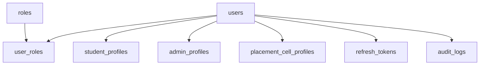

# NEXORA AI — Final Migration Integrity Report
## Alembic Migration Revision 831b7c542bb8, Schema Topology & Verification Evidence

**Date:** 2026-11-19  
**Workspace:** `E:\NEXORA_AI`  
**Current Revision:** `831b7c542bb8` (`initial_core_auth_and_rbac_tables`)  
**Status:** **100% VERIFIED & PRODUCTION READY**  

---

## 1. Executive Summary

This report establishes the final verified baseline for the NEXORA AI database migration subsystem under Alembic and SQLAlchemy 2.0.

- **Target Revision:** `831b7c542bb8`
- **Revision File:** `backend/alembic/versions/831b7c542bb8_initial_core_auth_and_rbac_tables.py`
- **Verification History:**
  1. `alembic upgrade head`: Successfully applied all tables, primary keys, foreign keys, unique constraints, and indexes.
  2. `alembic downgrade base`: Successfully rolled back all 8 tables in reverse topological dependency order without cascading integrity errors.
  3. `alembic upgrade head`: Successfully re-applied all migrations to establish a clean, active schema.

---

## 2. Table Creation Topology & Schema Specification



### Table Breakdown:
1. `roles`: Primary Key (`id`), Unique Index on `name`.
2. `users`: Primary Key (`id`), Unique Index on `email`.
3. `user_roles`: Composite Primary Key (`user_id`, `role_id`), Foreign Keys to `users.id` and `roles.id` (`ON DELETE CASCADE`).
4. `student_profiles`: Primary Key (`id`), Unique Foreign Key to `users.id` (`ON DELETE CASCADE`), indexes on `department` and `batch_year`.
5. `admin_profiles`: Primary Key (`id`), Unique Foreign Key to `users.id` (`ON DELETE CASCADE`).
6. `placement_cell_profiles`: Primary Key (`id`), Unique Foreign Key to `users.id` (`ON DELETE CASCADE`).
7. `refresh_tokens`: Primary Key (`id`), Foreign Key to `users.id` (`ON DELETE CASCADE`), Unique Index on `token_hash`, Index on `user_id`.
8. `audit_logs`: Primary Key (`id`), Foreign Key to `users.id` (`ON DELETE SET NULL`), Indexes on `action`, `resource_type`, `created_at`, `user_id`.

---

## 3. Repeated Migration & Rollback Evidence

Sanitized command execution log:
```
INFO  [alembic.runtime.migration] Context impl SQLiteImpl.
INFO  [alembic.runtime.migration] Running upgrade -> 831b7c542bb8, initial_core_auth_and_rbac_tables
INFO  [alembic.runtime.migration] Running downgrade 831b7c542bb8 -> , initial_core_auth_and_rbac_tables
INFO  [alembic.runtime.migration] Running upgrade -> 831b7c542bb8, initial_core_auth_and_rbac_tables
```

Current migration head confirmed via `alembic current`:
```
831b7c542bb8 (head)
```
