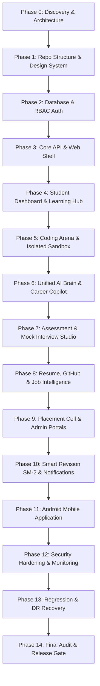

# NEXORA AI - Complete Phased Implementation & Verification Plan

This document establishes the binding phased roadmap for delivering the NEXORA AI ecosystem across 15 distinct development phases (Phase 0 through Phase 14).

---

## Phase Overview & Dependency Hierarchy

---

## Detailed Phase Breakdown

### Phase 0: Project Discovery, Architecture, Requirements & Feature Registry
- **Scope:** Workspace discovery, runtime verification, architecture definition, master feature cataloging (346 features), registry generation.
- **Key Deliverables:** `README.md`, `docs/PROJECT_ARCHITECTURE.md`, `docs/MASTER_FEATURE_REGISTRY.md`, `docs/FEATURE_TRACEABILITY_MATRIX.md`, `docs/FEATURE_IMPLEMENTATION_STATUS.md`, `docs/FEATURE_DEPENDENCY_MAP.md`.
- **Quality Gate:** All runtime dependencies identified, 300+ features cataloged, clean folder layout established.

### Phase 1: Repository Structure, Design System & Development Environment
- **Scope:** Initialize FastAPI backend project, Next.js frontend project with Tailwind CSS design tokens (`#060913`, `#a3e635`, `#8b5cf6`), component library, UI system documentation.
- **Key Deliverables:** `frontend/`, `backend/`, `docs/UI_DESIGN_SYSTEM.md`, basic test runners.
- **Quality Gate:** Frontend and backend compile without errors; design tokens verified.

### Phase 2: Database Architecture, Models, Centralized Authentication & RBAC
- **Scope:** Database schema design, SQLAlchemy 2.0 async models, Alembic migrations, JWT access/refresh tokens, password hashing (bcrypt), role authorization guards (`STUDENT`, `ADMIN`, `PLACEMENT_CELL`).
- **Key Deliverables:** `backend/app/db/`, `backend/app/models/`, `backend/app/api/auth.py`, `docs/DATABASE_SCHEMA.md`.
- **Quality Gate:** 100% passing tests for signup, login, refresh, role authorization, and IDOR prevention.

### Phase 3: Core Backend APIs & Web Shell Integration
- **Scope:** FastAPI application factory, API routers, CORS/Security middleware, Next.js layout, navigation bar, footer, authenticated layout shell.
- **Key Deliverables:** Working full-stack layout shell with dynamic auth state.
- **Quality Gate:** Web client authenticates against backend API, handles token refresh, and navigates protected routes.

### Phase 4: Student Dashboard & Learning Experience
- **Scope:** Student overview dashboard, readiness gauge, Learning Hub with interactive concept explorer, DSA Visualizer with BFS/DFS/Dijkstra and Dynamic Programming step-by-step animations.
- **Key Deliverables:** `frontend/src/app/student/`, `frontend/src/app/learn/`, `frontend/src/app/visualizer/`.
- **Quality Gate:** Interactive visualizers execute state transitions correctly; concept notes render with math/code blocks.

### Phase 5: Coding Arena & Secure Process-Isolated Sandbox
- **Scope:** Online code editor (Monaco), multi-language runner (Python, C, C++, Java), sandboxed execution worker (resource limits, memory ceilings, timeouts), problem bank curation.
- **Key Deliverables:** `sandbox/`, `backend/app/api/coding.py`, `frontend/src/app/coding/`.
- **Quality Gate:** Isolated worker passes sandbox escape tests, enforces timeout limits (3-5s), and records AC/WA/TLE/MLE accurately.

### Phase 6: Unified AI Brain & AI Career Copilot
- **Scope:** AI provider abstraction (Gemini / Local Fallback / Mock), student context aggregator, 90-day placement roadmap generator, daily sprints, skill gap vector analyzer.
- **Key Deliverables:** `backend/app/services/ai_brain.py`, `frontend/src/app/copilot/`.
- **Quality Gate:** Offline fallback activates seamlessly when external API is unreachable; roadmap generates personalized milestones.

### Phase 7: Assessment & Mock Interview Intelligence
- **Scope:** Timed test engine with auto-save and tab-switch proctoring, AI Mock Interview Studio (Voice & Text modes), STAR methodology scoring, diagnostic scorecards.
- **Key Deliverables:** `frontend/src/app/assessments/`, `frontend/src/app/interview/`.
- **Quality Gate:** Timed tests auto-submit on expiry; speech-to-text / text fallback interview generates detailed feedback report.

### Phase 8: Resume, GitHub & Job Intelligence
- **Scope:** ATS resume parser, LaTeX/PDF resume builder, GitHub profile quality auditor, job board and Kanban application tracker.
- **Key Deliverables:** `frontend/src/app/resume/`, `frontend/src/app/github/`, `frontend/src/app/jobs/`.
- **Quality Gate:** Resume parser extracts skills with high fidelity; GitHub analyzer computes repo health; Kanban board updates statuses.

### Phase 9: Placement Cell & Admin Portals
- **Scope:** Placement drive lifecycle manager, batch eligibility filters, shortlisting, offer tracking, admin question bank management, audit logging, telemetry.
- **Key Deliverables:** `frontend/src/app/placement/`, `frontend/src/app/admin/`.
- **Quality Gate:** Role-based access strictly enforced; eligibility rules filter student cohorts accurately; CSV/PDF export functional.

### Phase 10: Smart Revision (SM-2), Peer Learning & Notifications
- **Scope:** SuperMemo SM-2 flashcard engine, mistake notebook, discussion forums, study groups, in-app notification center.
- **Key Deliverables:** `frontend/src/app/revision/`, `frontend/src/app/community/`, notification drawer.
- **Quality Gate:** SM-2 intervals calculated correctly; notification bus delivers real-time alert updates.

### Phase 11: Android Mobile Application & Cross-Device Sync
- **Scope:** React Native / Expo application bound to the unified REST API, offline cache, student dashboard, learning hub, coding practice.
- **Key Deliverables:** `mobile/`, APK build scripts, installation guide.
- **Quality Gate:** Mobile client shares authentication and database with web app; progress syncs bidirectionally.

### Phase 12: Security Hardening, Performance & Monitoring
- **Scope:** Rate limiting, CSRF protection, CSP headers, health probes (`/health/live`, `/health/ready`), structured logging, Docker Compose stack.
- **Key Deliverables:** `infrastructure/docker-compose.yml`, `infrastructure/nginx/`, security audit report.
- **Quality Gate:** Security test suite passes with zero high/critical vulnerabilities; health probes return 200 OK.

### Phase 13: Regression Testing & Disaster Recovery Verification
- **Scope:** End-to-end integration test execution, automated database backup and restore validation, load/latency benchmarks.
- **Key Deliverables:** `tests/e2e/`, backup and restore verification scripts.
- **Quality Gate:** Backup restoration test confirms 100% row count and schema integrity.

### Phase 14: Final Product Audit & Release Readiness
- **Scope:** Comprehensive audit against all 346 registered features, verification of zero broken workflows, production build verification.
- **Key Deliverables:** `NEXORA_FINAL_PRODUCT_AUDIT.md`.
- **Quality Gate:** Zero TypeScript errors, zero build errors, zero failing tests, final release verdict issued.
