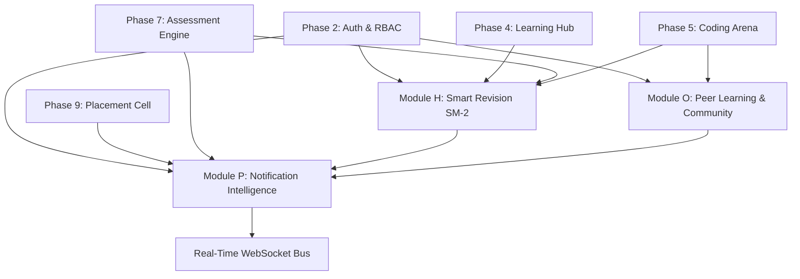

# NEXORA AI — PHASE 10 DEPENDENCY & ARCHITECTURE ANALYSIS

**Workspace:** `E:\NEXORA_AI`  
**Phase:** 10 (Smart Revision, Peer Learning & Notifications)  
**Baseline Git SHA:** `dcfbb9cbfb013d66d40242b48b9f2a27060568a8`  

---

## 1. Upstream & Cross-Module Dependencies

Phase 10 builds directly upon foundational capabilities delivered across Phases 0 through 9:

### Detailed Dependency Breakdown:
1. **Core Auth & Security (Phase 2):**
   - User identity, tokens (`get_current_user`), and role protection (`require_role("STUDENT")`, `require_role("ADMIN")`).
2. **Learning Hub & Mistake Ingestion (Phase 4, Phase 5, Phase 7):**
   - Failed test submissions (`CodeSubmission`, `AssessmentAnswer`) feed into `FEAT-147` (Weak-Topic Auto-Deck Generator) and `FEAT-155` (Mistake Notebook & Error Log).
3. **Coding Arena Integration (Phase 5):**
   - Question-specific doubt threads (`FEAT-278`) bind directly to `coding_problems.id`.
   - Peer solution comparison (`FEAT-282`) inspects accepted student submissions.
4. **Placement Drive Lifecycle (Phase 9):**
   - New drives, shortlisting transitions, and schedule announcements trigger high-priority alerts (`FEAT-295`).
5. **Career Copilot & Learning Streaks (Phase 6):**
   - Daily streak tracking signals feed into `FEAT-297` (Streak Loss Warning Alert).

---

## 2. Shared Services & Reuse Opportunities

Instead of adding unneeded external dependencies or paid third-party vendors, Phase 10 will strictly leverage existing infrastructure:

1. **SuperMemo SM-2 Math Core (`services/sm2_service.py`):**
   - Pure Python mathematical implementation of E-Factor:
     $$\text{EF}' = \text{EF} + (0.1 - (5 - q) \times (0.08 + (5 - q) \times 0.02))$$
     Where $q \in [0, 5]$ (mapped from Again=1, Hard=3, Good=4, Easy=5).
   - Zero external libraries required.
2. **PostgreSQL 17 JSONB & Full-Text Search:**
   - Discussion forums (`FEAT-290`) and flashcard search (`FEAT-159`) can utilize PostgreSQL full-text search (`tsvector`, `tsquery`) and GIN indexes, avoiding Elasticsearch overhead.
3. **Asynchronous WebSocket Notification Bus (`FEAT-308`):**
   - FastAPI native `WebSocket` endpoints and an in-memory `ConnectionManager` with user-targeted routing.
   - Clean fallback to polling (`/api/v1/notifications/unread-count`) if WebSocket connection drops.
4. **Transactional Email Service (`FEAT-300`):**
   - Standard Python `aiosmtplib` / `email.mime` sending over configurable SMTP (or local console development sink), completely free and self-hosted.

---

## 3. Database Architecture Planning

To maintain schema integrity without modifying any existing Phase 0–9 tables, a dedicated, forward-only Alembic migration will introduce 10 clean tables across the three functional modules:

### Module H: Smart Revision & Spaced Repetition (4 Tables)
1. `flashcard_decks`: User and pre-built flashcard deck containers (title, category, tags, is_public).
2. `flashcard_items`: Individual flashcards (front/back prompt, explanation, audio_url, code_snippet).
3. `student_card_reviews`: SuperMemo SM-2 state tracking per student (repetition, interval_days, ease_factor, next_review_at).
4. `mistake_notebook_entries`: Automated capture of failed coding test cases and assessment errors.

### Module O: Peer Learning & Community (4 Tables)
5. `peer_discussion_threads`: Categorized forum threads and problem-specific doubt discussions.
6. `peer_discussion_replies`: Discussion responses, code explanations, upvotes, and accepted answer markings.
7. `peer_study_groups`: Student study circles, target milestones, and group goals.
8. `peer_study_group_members`: Study group membership, roles (creator, member), and activity points.

### Module P: Notification Intelligence (2 Tables)
9. `user_notifications`: In-app notification center records (category, urgency, title, payload, is_read, read_at).
10. `user_notification_preferences`: Per-category channel toggles (in-app, email, push, quiet hours).

All 10 tables enforce:
- Foreign keys pointing to `users.id` with `ON DELETE CASCADE`.
- Tenant/student isolation indexing (`user_id`, `created_at`, `status`).
- Strict non-destructive migration design.
