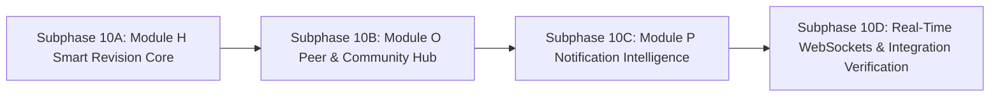

# NEXORA AI — PHASE 10 IMPLEMENTATION ROADMAP

**Workspace:** `E:\NEXORA_AI`  
**Phase:** 10 (Smart Revision, Peer Learning & Notifications)  
**Total Canonical Scope:** 50 Features (`FEAT-145` to `FEAT-162`, `FEAT-277` to `FEAT-308`)  

---

## Proposed Subphase Implementation Sequencing

### Subphase 10A: Module H — Smart Revision & Spaced Repetition (FEAT-145 to FEAT-162)
* **Features Included:** 18 features (`FEAT-145` through `FEAT-162`).
* **Prerequisites:** Phase 2 Auth & Database architecture, Phase 4 Concept Explorer, Phase 5 Coding Submissions, Phase 7 Assessment Attempts.
* **Backend Deliverables:**
  - `backend/app/models/phase10_revision.py`
  - `backend/app/schemas/phase10_revision.py`
  - `backend/app/services/sm2_service.py` & `backend/app/services/revision_service.py`
  - `backend/app/api/revision.py`
* **Frontend Deliverables:**
  - `frontend/src/app/revision/page.tsx` (Flashcard player, flip animation, review session timer, mistake notebook drawer).
* **Database Deliverables:**
  - Alembic migration for `flashcard_decks`, `flashcard_items`, `student_card_reviews`, `mistake_notebook_entries`.
* **Testing Gate:** SM-2 mathematical correctness tests, interval calculation unit tests, rating progression integration tests.

---

### Subphase 10B: Module O — Peer Learning & Community Platform (FEAT-277 to FEAT-292)
* **Features Included:** 16 features (`FEAT-277` through `FEAT-292`).
* **Prerequisites:** Subphase 10A complete; User Profile & Student models.
* **Backend Deliverables:**
  - `backend/app/models/phase10_peer.py`
  - `backend/app/schemas/phase10_peer.py`
  - `backend/app/services/peer_service.py` (Forums, doubt threads, karma calculation, toxic moderation heuristics).
  - `backend/app/api/peer.py`
* **Frontend Deliverables:**
  - `frontend/src/app/community/page.tsx` (Discussion forums, study circle lobby, Pomodoro study timer, markdown editor).
* **Database Deliverables:**
  - Alembic migration for `peer_discussion_threads`, `peer_discussion_replies`, `peer_study_groups`, `peer_study_group_members`.
* **Testing Gate:** Discussion creation, thread nesting, upvoting/karma transactions, moderation rule enforcement tests.

---

### Subphase 10C: Module P — Notification Intelligence Core (FEAT-293 to FEAT-307)
* **Features Included:** 15 features (`FEAT-293` through `FEAT-307`):
  - In-app notification center drawer (`FEAT-293`).
  - Preferences and channel toggles (`FEAT-294`).
  - Placement drive urgency alerts (`FEAT-295`).
  - Assessment & test schedule reminders (`FEAT-296`).
  - Daily streak loss warning alert (`FEAT-297`).
  - Spaced repetition review due notification (`FEAT-298`).
  - Peer reply and mention notification (`FEAT-299`).
  - Transactional email delivery engine (`FEAT-300`).
  - Browser web push notifications (`FEAT-301`).
  - Notification delivery history & audit (`FEAT-302`).
  - Batch notification queue worker (`FEAT-303`).
  - Notification snooze and quiet hours (`FEAT-304`).
  - Custom webhook dispatcher for colleges (`FEAT-305`).
  - Rich HTML email templates (`FEAT-306`).
  - Unsubscribe and notification management link (`FEAT-307`).
* **Prerequisites:** Subphases 10A & 10B complete; Phase 8 Job Matcher, Phase 9 Placement alerts.
* **Backend Deliverables:**
  - `backend/app/models/phase10_notifications.py`
  - `backend/app/schemas/phase10_notifications.py`
  - `backend/app/services/notification_service.py` (In-app dispatcher, preferences manager, email template renderer).
  - `backend/app/api/notifications.py`
* **Frontend Deliverables:**
  - Notification drawer component in global layout header (`frontend/src/components/layout/Navbar.tsx`).
  - Notification preference center tab in `/student/dashboard`.
* **Database Deliverables:**
  - Alembic migration for `user_notifications`, `user_notification_preferences`.
* **Testing Gate:** Notification queuing, delivery preference filtering, unread count badge accuracy, email template rendering tests.

---

### Subphase 10D: Real-Time WebSocket Bus & End-to-End Certification (FEAT-308)
* **Features Included:** 1 feature (`FEAT-308`: Real-Time WebSocket Notification Bus) + Full Suite Integration.
  - Subphase 10C (15 features) + Subphase 10D (1 feature) = Exactly 16 Module P features (`FEAT-293`..`FEAT-308`).
* **Prerequisites:** Subphases 10A, 10B, 10C operational.
* **Backend Deliverables:**
  - `backend/app/api/websocket_notifications.py` (WebSocket connection manager with authentication handshake).
* **Frontend Deliverables:**
  - WebSocket client hook in `frontend/src/components/layout/Navbar.tsx` for real-time badge updates.
* **Testing Gate:** WebSocket handshake authentication, instant event dispatching, reconnection resilience, full regression suite execution across Phases 0–10.
