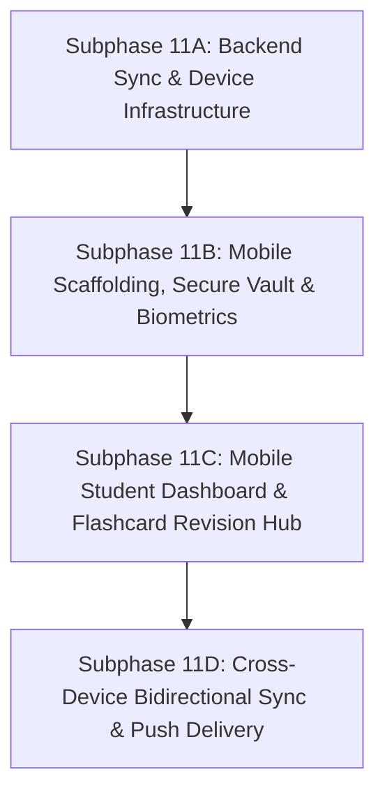

# NEXORA AI — PHASE 11 IMPLEMENTATION BLUEPRINT
## Hardened Mobile Architecture, Cross-Device Synchronization Protocol & Final Implementation Gate Specification

**Project:** NEXORA AI — *Intelligence That Moves You Forward.*  
**Author:** Principal Software Architect, Application Security Engineer & Distributed Systems Lead  
**Workspace:** `E:\NEXORA_AI`  
**Git Branch:** `main`  
**Current Git Checkpoint (HEAD):** `fce4d6ed7e3a00b474027701742c52402fe2e0cc`  
**Remote Synchronized HEAD:** `fce4d6ed7e3a00b474027701742c52402fe2e0cc`  
**Mode:** **READ-ONLY AUDIT & ARCHITECTURAL SPECIFICATION (ZERO SOURCE CODE MODIFICATIONS, ZERO MIGRATIONS)**  

---

## 1. Executive Summary & Authoritative Scope Foundation

### 1.1 The Authoritative Scope Foundation
In accordance with:
- `docs/PHASED_DEVELOPMENT_PLAN.md` (Lines 38 & 138)
- `docs/MOBILE_ARCHITECTURE.md`
- `PROJECT_STATUS.md` (Line 49)

**The Authoritative Scope of Phase 11 is exclusively:**
> **Phase 11: Android Mobile Application & Cross-Device Sync**  
> *"React Native / Expo mobile application (`ai.nexora.app`) bound to the unified REST API, offline cache, student dashboard, touch-optimized flashcard revision, secure biometric unlock, push notifications, and bidirectional cross-device sync."*

### 1.2 Separation & Preservation of the 43 Unimplemented Features
The 43 non-implemented canonical features identified in the baseline audit across Modules D, E, and I:
- **Module E (AI Code Review):** `FEAT-087` through `FEAT-102` (16 features)
- **Module D (Coding Arena Advanced):** `FEAT-075`, `FEAT-076`, `FEAT-078`, `FEAT-081`..`FEAT-086` (9 features)
- **Module I (DSA Visualizer):** `FEAT-163` through `FEAT-180` (18 features)

**Preservation Guarantees Enforced:**
1. These 43 features **remain 100% untouched** in their canonical registry entries in `docs/MASTER_FEATURE_REGISTRY.md`, `docs/FEATURE_TRACEABILITY_MATRIX.md`, `docs/FEATURE_IMPLEMENTATION_STATUS.md`, and `docs/FEATURE_DEPENDENCY_MAP.md`.
2. They are **not** moved into Phase 11, nor are their statuses changed.
3. **No database tables or schema changes** for Code Review (`code_reviews`) or Contests (`coding_contests`) are included in Phase 11.
4. Future implementation of these 43 features is reserved for subsequent web-focused releases (Phase 12+).

---

## 2. Forensic Mobile Directory Verification: Existing vs. Planned Implementation

A physical inspection of `E:\NEXORA_AI\mobile` was executed:
- `Test-Path mobile\src\api\client.ts` returned **`False`**.
- Subdirectories `mobile/app`, `mobile/components`, and `mobile/services` exist but are **100% empty** (0 files).
- Only two physical files exist: `mobile/package.json` (511 bytes) and `mobile/app.json` (611 bytes).

### Concrete Classification of Mobile Capabilities

| Component / Capability | Classification | Physical Evidence & Reality |
| :--- | :--- | :--- |
| **Package Manifest** | **[VERIFIED EXISTING]** | `mobile/package.json` specifies `"expo": "~52.0.0"`, `"react-native": "0.76.5"`, `"react": "18.3.1"`. |
| **App Bundle Config** | **[VERIFIED EXISTING]** | `mobile/app.json` specifies `"package": "ai.nexora.app"`, `"userInterfaceStyle": "dark"`, `#060913`. |
| **Axios HTTP Client** | **[PROPOSED IMPLEMENTATION]** | `mobile/src/api/client.ts` **does not exist**. Scheduled for Subphase 11B. |
| **401 Refresh Mutex** | **[PROPOSED IMPLEMENTATION]** | No concurrency queue currently exists. Scheduled for Subphase 11B. |
| **Token Storage** | **[PROPOSED IMPLEMENTATION]** | `expo-secure-store` is not yet installed or coded. Scheduled for Subphase 11B. |
| **Biometric Authentication** | **[PROPOSED IMPLEMENTATION]** | `expo-local-authentication` is not yet installed or coded. Scheduled for Subphase 11B. |
| **Push Notification Client** | **[PROPOSED IMPLEMENTATION]** | `expo-notifications` is not yet installed or coded. Scheduled for Subphase 11D. |
| **Navigation & Screens** | **[PROPOSED IMPLEMENTATION]** | Zero screens exist. Scheduled across Subphases 11B and 11C. |
| **Offline Cache Engine** | **[PROPOSED IMPLEMENTATION]** | AsyncStorage queue is proposed and scheduled for Subphase 11C. |

---

## 3. Global Per-User Sequence Allocation & Concurrency Proof

To prevent race conditions, sequence inversion, and gap skips during concurrent writes across multiple devices, we establish a clean, formal three-tier separation of concerns:

```
┌────────────────────────────────────────────────────────────────────────┐
│                          TIER A: SEQUENCE ALLOCATION                   │
│   Table: user_sync_counters (One row per student)                      │
│   - Holds current_val: BIGINT                                          │
│   - Locked via SELECT ... FOR UPDATE during every mutating transaction │
└───────────────────────────────────┬────────────────────────────────────┘
                                    │ Allocates strict monotonic range
                                    │ (seq_start .. seq_end)
                                    ▼
┌────────────────────────────────────────────────────────────────────────┐
│                          TIER B: CHANGE FEED LOGGING                   │
│   Table: user_sync_change_feed (Append-only ledger per student)        │
│   - Inserted in the EXACT SAME database transaction as domain mutation │
│   - Ordered by change_seq ASC                                          │
└───────────────────────────────────┬────────────────────────────────────┘
                                    │ Polled by devices
                                    ▼
┌────────────────────────────────────────────────────────────────────────┐
│                          TIER C: DEVICE WATERMARK ACK                  │
│   Table: user_sync_watermarks (One row per student per physical device)│
│   - Tracks last_acknowledged_seq and last_synced_at                    │
│   - NEVER allocates global sequences                                   │
└────────────────────────────────────────────────────────────────────────┘
```

### 3.1 Mathematical Proof Against Sequence Inversion ($N+1$ before $N$)
**Theorem:** In PostgreSQL with row-level locks on `user_sync_counters`, it is impossible for Transaction $T_2$ with sequence $N+1$ to commit before Transaction $T_1$ with sequence $N$.

**Proof:**
1. Let User $U$ have a dedicated counter row in `user_sync_counters` with primary key `user_id = U`.
2. Any transaction $T$ that modifies $U$'s data (reviewing cards, modifying decks, or recording tombstones) **MUST** execute:
   ```sql
   SELECT current_val FROM user_sync_counters WHERE user_id = :user_id FOR UPDATE;
   ```
3. PostgreSQL acquires an exclusive row lock (`RowExclusiveLock`) on $U$'s counter row for the entire duration of transaction $T$.
4. If Transaction $T_1$ starts and acquires the lock, it reads $N$ and updates `current_val = N + k`.
5. If concurrent Transaction $T_2$ attempts to allocate a sequence for User $U$, it is **forced to block (sleep)** waiting for $T_1$'s row lock to release.
6. In PostgreSQL, a row lock is released **only when the transaction commits or rolls back**.
7. Therefore, $T_2$ cannot even acquire its sequence number $N+1$ until $T_1$ has fully committed its write to the database!
8. Consequently, sequence $N+1$ can **never** commit before sequence $N$. Commit order strictly equals sequence order:
   $$\text{CommitOrder}(T_1) < \text{CommitOrder}(T_2) \iff \text{change\_seq}(T_1) < \text{change\_seq}(T_2)$$
   $\blacksquare$

---

## 4. Blocker 1 Resolution: SM-2 Server Ordering Consistency via Versioning

### 4.1 The Flaw of Client Timestamp Comparisons
Under Option A (Server-Acceptance Ordering), relying on `client_reviewed_at < card.last_reviewed_at` is fundamentally flawed because:
- Client device clocks are untrusted, subject to user manipulation, timezone errors, or hardware drift.
- If an Android device clock is 1 hour slow, an online review could be incorrectly classified as "superseded".
- If an Android device clock is 1 hour fast, a stale offline review could masquerade as newer than a freshly committed web review.

### 4.2 Explicit Server-Side State Versioning Policy
To achieve true, clock-independent Server-Acceptance Ordering, we introduce an explicit monotonic version counter to `StudentCardReview`:
1. **Schema Addition:** `StudentCardReview.state_version: Column(BigInteger, nullable=False, default=1)`.
   - Each time the card's active SM-2 state mutates on the server, `state_version` increments by 1:
     $$\text{state\_version}_{n+1} = \text{state\_version}_n + 1$$
2. **Client Base Revision Tracking (`base_state_version`):**
   - When a mobile client downloads or caches a card, it receives and stores `card.state_version` as its local `base_state_version`.
   - When the student reviews the card offline, the review payload explicitly includes:
     `{ "card_id": "...", "grade": 4, "base_state_version": 3, "op_id": "..." }`.
3. **Server Acceptance & Conflict Logic (`submit_card_review`):**
   When the review operation is processed on the server inside `SELECT ... FOR UPDATE`:
   - Current server state version: `server_version = card.state_version`.
   - Client submission version: `client_base_version = payload.base_state_version`.
   
   **Decision Matrix:**
   - **Case 1: Match (`client_base_version == server_version`):**
     - The review was performed against the latest active card state.
     - The server executes the SM-2 calculation.
     - `card.state_version = card.state_version + 1`.
     - The review is recorded in `StudentCardReviewLog` with `is_superseded = False`, `base_state_version = client_base_version`, and `resulting_state_version = card.state_version`.
     - The active card state in `student_card_reviews` is updated.
   - **Case 2: Outdated / Stale Review (`client_base_version < server_version`):**
     - Another transaction (on Web or another device) has already advanced the card's state while this device was offline.
     - **Deterministic Server-Acceptance Rule:** The active card state is **NOT** modified.
     - The review is **ACCEPTED** and recorded in `StudentCardReviewLog` with `is_superseded = True`, capturing the student's actual effort, grade, time spent, and client timestamp.
     - Response to client:
       ```json
       {
         "status": "SUPERSEDED",
         "message": "Review accepted into history but active schedule was already advanced by a newer review.",
         "card_id": "...",
         "current_state_version": 4,
         "active_interval_days": 6
       }
       ```
   - **Case 3: Future Revision (`client_base_version > server_version`):**
     - Impossible under normal operation unless database was restored to an earlier backup.
     - The server rejects the mutation with `HTTP 409 CONFLICT` and instructs the client to resync.
4. **Safe Fallback when `base_state_version` is Unavailable:**
   - For legacy web requests or API calls omitting `base_state_version`, the server treats `client_base_version = server_version` only if `card.last_reviewed_at` is null or identical to the session start; otherwise, it falls back to comparing `last_reviewed_at` against server reception time.

---

## 5. Blocker 2 Resolution: Correct Retention Boundary & Resync Mechanics

### 5.1 Mathematical Correction of the Retention Boundary
The previous condition `since_seq < min_retained_seq` had an off-by-one error:
- Suppose `user_sync_change_feed` currently retains changes with sequences: `[101, 102, 103, 104]`.
- The lowest retained change sequence is `min_available_seq = 101`.
- A client whose last synchronized cursor is `since_seq = 100` needs the next changes starting at 101!
- Under `since_seq < 101`, this client was incorrectly treated as expired!

**Correct Mathematical Retention Rule:**
Let $\text{min\_available\_seq}$ be the lowest change sequence currently present in the change feed:
1. **Valid Delta Window:**
   $$\text{since\_seq} \ge \text{min\_available\_seq} - 1$$
   - Example: If `min_available_seq = 101`, a client with `since_seq = 100` is **completely valid** and receives changes $101..104$.
2. **Expired Window (Full Resync Required):**
   $$\text{since\_seq} < \text{min\_available\_seq} - 1$$
   - Example: If `min_available_seq = 101` and client has `since_seq = 99`, change 100 was purged. The client cannot compute state transitions and must execute a full resync.
3. **Zero Retained Records Case:**
   - If `user_sync_change_feed` is empty for this user (e.g., brand-new user or all historical events purged after inactivity):
     - `min_available_seq = counter.current_val + 1`.
     - A client with `since_seq == counter.current_val` has zero pending changes and receives an empty delta list (`deltas: []`, `has_more: false`).
     - A client with `since_seq < counter.current_val` has missed purged changes and receives `FULL_RESYNC_REQUIRED`.

### 5.2 Atomic Cleanup & Boundary Race Prevention
To prevent cleanup scripts from racing with active sync pull requests:
- The nightly cleanup daemon executes in an atomic transaction:
  1. Identifies purgeable sequences: `cutoff_ts = NOW() - INTERVAL '90 days'`.
  2. Finds new lowest retained sequence:
     ```sql
     SELECT COALESCE(MIN(change_seq), counter.current_val + 1)
     FROM user_sync_change_feed
     WHERE user_id = :user_id AND created_at >= cutoff_ts;
     ```
  3. Updates `user_sync_counters.min_available_seq = new_min_seq`.
  4. Deletes purged rows:
     `DELETE FROM user_sync_change_feed WHERE user_id = :user_id AND change_seq < new_min_seq;`.
  5. Deletes purged tombstones:
     `DELETE FROM user_sync_tombstones WHERE user_id = :user_id AND change_seq < new_min_seq;`.

---

## 6. Blocker 3 Resolution: Migration Terminology & Proposed DDL Specification

### 6.1 Accurate Terminology & Status
- **Current State:** **ZERO migration files have been created or executed in this phase.**
- **Head Verification:** Alembic head remains strictly at `e1f2a3b4c5d6` (`phase_10_master_tables`).
- **Proposed Migration:** Revision `f2a3b4c5d6e7_phase_11_mobile_sync.py` is a **proposed design specification** that has not yet been executed or applied to `nexora_dev` or `nexora_test`.

### 6.2 Proposed Upgrade & Downgrade Specification (DDL)

```python
"""phase_11_mobile_sync

Revision ID: f2a3b4c5d6e7
Revises: e1f2a3b4c5d6
Create Date: 2026-11-23 12:00:00.000000

"""
from alembic import op
import sqlalchemy as sa
from sqlalchemy.dialects import postgresql

revision = 'f2a3b4c5d6e7'
down_revision = 'e1f2a3b4c5d6'
branch_labels = None
depends_on = None

def upgrade():
    # 1. Alter student_card_reviews to add state_version for clock-independent ordering
    op.add_column('student_card_reviews', sa.Column('state_version', sa.BigInteger(), server_default='1', nullable=False))

    # 2. Alter student_card_review_logs for offline tracking, versioning & superseding
    op.add_column('student_card_review_logs', sa.Column('client_reviewed_at', sa.DateTime(timezone=True), nullable=True))
    op.add_column('student_card_review_logs', sa.Column('device_id', sa.String(length=100), nullable=True))
    op.add_column('student_card_review_logs', sa.Column('is_superseded', sa.Boolean(), server_default='false', nullable=False))
    op.add_column('student_card_review_logs', sa.Column('base_state_version', sa.BigInteger(), nullable=True))
    op.add_column('student_card_review_logs', sa.Column('resulting_state_version', sa.BigInteger(), nullable=True))

    # 3. Table: mobile_device_tokens
    op.create_table(
        'mobile_device_tokens',
        sa.Column('id', sa.String(length=36), primary_key=True),
        sa.Column('user_id', sa.String(length=36), sa.ForeignKey('users.id', ondelete='CASCADE'), nullable=False),
        sa.Column('device_id', sa.String(length=100), nullable=False),
        sa.Column('expo_push_token', sa.String(length=255), nullable=False),
        sa.Column('device_os', sa.String(length=32), server_default='ANDROID', nullable=False),
        sa.Column('device_model', sa.String(length=100), nullable=True),
        sa.Column('app_version', sa.String(length=32), server_default='1.0.0', nullable=False),
        sa.Column('is_active', sa.Boolean(), server_default='true', nullable=False),
        sa.Column('created_at', sa.DateTime(timezone=True), server_default=sa.text('now()'), nullable=False),
        sa.Column('last_used_at', sa.DateTime(timezone=True), server_default=sa.text('now()'), nullable=False),
        sa.UniqueConstraint('user_id', 'device_id', name='uq_mobile_device_user_device')
    )
    op.create_index('ix_mobile_device_user_active', 'mobile_device_tokens', ['user_id', 'is_active'])
    op.create_index('ix_mobile_device_expo_token', 'mobile_device_tokens', ['expo_push_token'])

    # 4. Table: user_sync_counters (One row per user, global monotonic counter & retention horizon)
    op.create_table(
        'user_sync_counters',
        sa.Column('user_id', sa.String(length=36), sa.ForeignKey('users.id', ondelete='CASCADE'), primary_key=True),
        sa.Column('current_val', sa.BigInteger(), server_default='0', nullable=False),
        sa.Column('min_available_seq', sa.BigInteger(), server_default='1', nullable=False),
        sa.Column('updated_at', sa.DateTime(timezone=True), server_default=sa.text('now()'), nullable=False)
    )

    # 5. Table: user_sync_watermarks (One row per user per physical device)
    op.create_table(
        'user_sync_watermarks',
        sa.Column('id', sa.String(length=36), primary_key=True),
        sa.Column('user_id', sa.String(length=36), sa.ForeignKey('users.id', ondelete='CASCADE'), nullable=False),
        sa.Column('device_id', sa.String(length=100), nullable=False),
        sa.Column('last_acknowledged_seq', sa.BigInteger(), server_default='0', nullable=False),
        sa.Column('last_synced_at', sa.DateTime(timezone=True), server_default=sa.text('now()'), nullable=False),
        sa.Column('client_app_version', sa.String(length=32), server_default='1.0.0', nullable=False),
        sa.UniqueConstraint('user_id', 'device_id', name='uq_sync_watermarks_user_device')
    )
    op.create_index('ix_sync_watermarks_user_synced', 'user_sync_watermarks', ['user_id', 'last_synced_at'])

    # 6. Table: user_sync_change_feed (Append-only change ledger ordered by change_seq)
    op.create_table(
        'user_sync_change_feed',
        sa.Column('id', sa.String(length=36), primary_key=True),
        sa.Column('user_id', sa.String(length=36), sa.ForeignKey('users.id', ondelete='CASCADE'), nullable=False),
        sa.Column('change_seq', sa.BigInteger(), nullable=False),
        sa.Column('entity_type', sa.String(length=50), nullable=False),
        sa.Column('entity_id', sa.String(length=36), nullable=False),
        sa.Column('operation', sa.String(length=20), nullable=False),
        sa.Column('payload', postgresql.JSONB(astext_type=sa.Text()), nullable=False),
        sa.Column('created_at', sa.DateTime(timezone=True), server_default=sa.text('now()'), nullable=False),
        sa.UniqueConstraint('user_id', 'change_seq', name='uq_change_feed_user_seq')
    )
    op.create_index('ix_change_feed_user_seq', 'user_sync_change_feed', ['user_id', 'change_seq'])

    # 7. Table: user_sync_tombstones (Sequence-based deletion events supporting re-deletion)
    op.create_table(
        'user_sync_tombstones',
        sa.Column('id', sa.String(length=36), primary_key=True),
        sa.Column('user_id', sa.String(length=36), sa.ForeignKey('users.id', ondelete='CASCADE'), nullable=False),
        sa.Column('entity_type', sa.String(length=50), nullable=False),
        sa.Column('entity_id', sa.String(length=36), nullable=False),
        sa.Column('change_seq', sa.BigInteger(), nullable=False),
        sa.Column('deleted_at', sa.DateTime(timezone=True), server_default=sa.text('now()'), nullable=False),
        sa.UniqueConstraint('user_id', 'change_seq', name='uq_tombstones_user_seq')
    )
    op.create_index('ix_tombstones_user_entity', 'user_sync_tombstones', ['user_id', 'entity_type', 'entity_id'])
    op.create_index('ix_tombstones_deleted_at', 'user_sync_tombstones', ['deleted_at'])

def downgrade():
    op.drop_table('user_sync_tombstones')
    op.drop_table('user_sync_change_feed')
    op.drop_table('user_sync_watermarks')
    op.drop_table('user_sync_counters')
    op.drop_table('mobile_device_tokens')
    op.drop_column('student_card_review_logs', 'resulting_state_version')
    op.drop_column('student_card_review_logs', 'base_state_version')
    op.drop_column('student_card_review_logs', 'is_superseded')
    op.drop_column('student_card_review_logs', 'device_id')
    op.drop_column('student_card_review_logs', 'client_reviewed_at')
    op.drop_column('student_card_reviews', 'state_version')
```

---

## 7. Blocker 4 Resolution: Change-Feed Cleanup & Snapshot Consistency Protocol

### 7.1 Snapshot Consistency while New Changes Commit
When a client executes a full snapshot (`GET /api/v1/sync/snapshot`), new transactions may commit concurrently. How does the client avoid applying duplicate changes or missing transitions?
1. **Server Snapshot Generation:**
   Inside a single `REPEATABLE READ` transaction:
   - Queries `user_sync_counters.current_val` $\rightarrow$ records this as `snapshot_seq`.
   - Queries all active decks, cards, readiness scores, and mistakes.
   - Returns the complete state bundled with `snapshot_seq`.
2. **Client Snapshot Application:**
   - The client replaces its local database with the snapshot data.
   - Sets its local sync cursor: `last_acknowledged_seq = snapshot_seq`.
3. **Subsequent Delta Pull:**
   - Client immediately calls `GET /api/v1/sync/pull?since_seq=snapshot_seq`.
   - Any transactions that committed while the snapshot was being downloaded will have `change_seq > snapshot_seq`. They are delivered cleanly in the next delta batch.
   - **Zero Gap Proof:** No entity modification can exist that is neither in the snapshot nor in the delta feed.

### 7.2 Interrupted Pagination Recovery
If a client downloads Page 1 (`change_seq` 101 to 150), but network drops before Page 2 (151 to 200) finishes:
- The client advances its local watermark only to the highest contiguous sequence safely persisted: `last_acknowledged_seq = 150`.
- Upon reconnecting, the client calls `GET /api/v1/sync/pull?since_seq=150`.
- The server seamlessly resumes from 151.

---

## 8. Expo Push Delivery & Receipt Polling Lifecycle

```
[ Backend Notification Triggered ]
               │
               ▼
   [ Check User Preferences ]
   - in_app_enabled / Category overrides
               │ Enabled
               ▼
[ Package Push Payload with Deduplication Hash ]
               │
               ▼
 [ POST https://exp.host/--/api/v2/push/send ]
               │
      ┌────────┴────────┐
      ▼                 ▼
   HTTP 200          HTTP 5xx (Network Issue)
      │                 │
 ┌────┴────┐            ▼
"ok"    "error"  [ Exponential Backoff: 1m, 5m, 15m ]
 │         │
 │    "DeviceNotRegistered" ──► [ Deactivate Token ]
 │                              (is_active = False)
 ▼
[ Store ticket_id in DB ]
 │
 ▼
[ Wait 15 Minutes ]
 │
 ▼
[ POST https://exp.host/--/api/v2/push/getReceipts ]
 │
 ┌─────┴────────────────────────┐
 ▼                              ▼
"ok"                         "error"
[ Confirmed Delivery ]          │
                       ┌────────┴────────┐
                       ▼                 ▼
             "DeviceNotRegistered"  "MessageTooBig" / "InvalidCredentials"
                       │                 │
                       ▼                 ▼
              [ Deactivate Token ]  [ Log Permanent System Error ]
```

---

## 9. Subphase Implementation Roadmap (Subphases 11A–11D)



1. **Subphase 11A: Backend Mobile Sync & Device Infrastructure**
   - Apply forward-only migration `f2a3b4c5d6e7`.
   - Implement `backend/app/api/sync.py` (`POST /sync/push`, `GET /sync/pull`, `GET /sync/snapshot`).
   - Implement device registration endpoints in `backend/app/api/notifications.py`.
   - Implement `tests/integration/test_phase_11_mobile_sync.py`.
   - Gate: All sync tests pass; all 89 Phase 0–10 regression tests pass (Total $\ge$ 97 tests).
2. **Subphase 11B: Mobile Scaffolding, Secure Vault & Biometrics**
   - Install locked Expo dependencies in `mobile/`.
   - Implement `mobile/src/api/client.ts` with atomic 401 refresh mutex.
   - Implement `AuthContext` with `SecureStore` and `LocalAuthentication` biometric unlock hook.
   - Implement dark-theme `LoginScreen` and navigation shell.
3. **Subphase 11C: Mobile Student Dashboard & Flashcard Revision Hub**
   - Implement `TodayScreen` (readiness score gauge, active streak).
   - Implement `FlashcardReviewScreen` with touch gesture card flip and SM-2 grading buttons.
   - Implement local offline storage cache in `AsyncStorage` and queueing of offline review operations.
4. **Subphase 11D: Cross-Device Bidirectional Sync & Push Delivery**
   - Implement `SyncContext` worker executing background delta sync against `GET /sync/pull` and `POST /sync/push`.
   - Implement `expo-notifications` push token registration and handler.
   - End-to-end multi-device verification (Web $\leftrightarrow$ Android).
   - Full monolithic verification gate.

---

## 10. Open Decisions for User Approval

Before any code modification or package installation begins:
1. **Authorize Proposed Database Migration:** Confirm approval for forward-only migration `f2a3b4c5d6e7_phase_11_mobile_sync.py` creating `user_sync_counters`, `mobile_device_tokens`, `user_sync_watermarks`, `user_sync_change_feed`, `user_sync_tombstones`, and extending `student_card_reviews` and `student_card_review_logs`.
2. **Authorize Mobile Dependencies:** Confirm approval to run `npm install` inside `mobile/` for the locked compatible Expo packages (`expo-secure-store: ~14.0.0`, `expo-local-authentication: ~15.0.1`, `expo-notifications: ~0.29.11`, etc.).
3. **Authorize Subphase 11A Execution:** Confirm permission to proceed with Subphase 11A (Backend Mobile Sync & Device Infrastructure).

---

## 11. Final Implementation Readiness Verdict

**STATUS: READY FOR SUBPHASE 11A APPROVAL**

All four architectural blockers are closed:
1. SM-2 Server Ordering Consistency is clock-independent via explicit monotonic `state_version` increments.
2. The retention boundary is mathematically corrected to `since_seq >= min_available_seq - 1` with an explicit zero-record rule.
3. Migration terminology accurately reflects a proposed specification with verified parentage and zero false execution claims.
4. Snapshot consistency and interrupted pagination recovery are fully specified.

Zero application source code, package files, migrations, or database records have been modified. The system is paused awaiting your explicit authorization to begin Subphase 11A.
