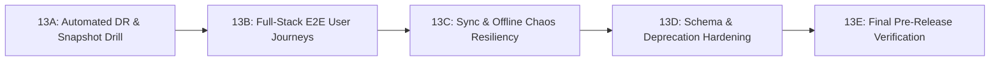

# NEXORA AI — PHASE 13 STRATEGIC BLUEPRINT
## Comprehensive E2E Regression, Automated Disaster Recovery & Full-System Resiliency

**Document Version:** 1.0.0  
**Target Phase:** Phase 13  
**Status:** BLUEPRINT PROPOSAL (Awaiting Review & Authorization — Zero Implementation Allowed)  
**Workspace Root:** `E:\NEXORA-AI-main\NEXORA-AI-main`  
**Binding Architecture Baseline:** Phases 0–12 Fully Implemented & Audited

---

## 1. Phase Identity & Objectives

- **Official Phase Name:** Phase 13 — Comprehensive E2E Regression, Automated Disaster Recovery & Full-System Resiliency
- **Primary Objective:** Execute full-lifecycle student, placement cell, and mobile cross-device user journeys, establish automated disaster recovery and database backup/restore verification drills, and validate platform fault tolerance under simulated process restarts and network degradation.
- **Expected Outcome:** An ironclad, crash-resilient ecosystem where student revision states, placement drive applications, and coding submissions survive database failovers, power cuts, and network disconnects with 100% data integrity and zero data loss.
- **Strict Scope Boundaries:**
  - In-Scope: Automated E2E journey scripts (`tests/e2e/`), automated database snapshot & point-in-time recovery test harnesses, crash-consistency audits, cross-device sync stress tests, and automated Pydantic V2 modernization.
  - Out-of-Scope: Deploying to public cloud, modifying production databases, running destructive DDL against `nexora_dev`, or writing external marketing features.

---

## 2. Subphase Architecture & Implementation Plan

### Subphase 13A: Automated Database Disaster Recovery & Snapshot Verification
- **Objective:** Build and verify automated backup creation, SHA-256 manifest verification, and point-in-time snapshot restoration drills.
- **Backend Work:** Create an automated backup runner in `backend/app/db/backup.py` supporting non-destructive SQLite/PostgreSQL schema and data export with cryptographic checksums.
- **Database Work:** Verify that restoring a snapshot reproduces 100% table row counts across all 11 model groups without primary key or foreign key drift.
- **Definition of Completion:** An automated test (`tests/unit/test_disaster_recovery_drill.py`) creates test data, creates a snapshot, wipes the test DB, restores from snapshot, and asserts exact entity equality.

### Subphase 13B: Full-Stack End-to-End User Journey Test Harness
- **Objective:** Simulate complete student placement preparation journeys spanning Registration -> Career Copilot Roadmap -> Learning Hub Progress -> Coding Arena Submissions -> SM-2 Flashcard Reviews.
- **Backend Work:** Create integrated journey suites in `tests/e2e/test_student_placement_journey.py` and `tests/e2e/test_placement_cell_drive_lifecycle.py`.
- **Frontend Verification:** Execute and verify Next.js page state transitions and authentication persistence across route transitions.
- **Definition of Completion:** Multi-step journey test runs end-to-end with 100% assertions green and zero 500 errors.

### Subphase 13C: Cross-Device Sync & Offline Queue Chaos Resiliency Drill
- **Objective:** Subject the mobile delta sync engine (`SyncEngineService`) and offline review queue (`OfflineQueueService`) to simulated network dropouts, 429 rate limit backoffs, and concurrent multi-device conflicting edits.
- **Mobile Work:** Author comprehensive mock stress tests in `mobile/src/tests/syncChaosResiliency.test.ts` verifying exponential backoff, client sequence ordering, and idempotency key deduplication.
- **Definition of Completion:** All 200 offline review items synchronize cleanly after simulated reconnect without duplicate entries or dropped grades.

### Subphase 13D: Pydantic V2 & Modernization Hardening
- **Objective:** Modernize all Pydantic v1-style `class Config` and deprecated validator decorators across schemas to eliminate all 21 runtime deprecation warnings.
- **Backend Work:** Upgrade schemas in `backend/app/schemas/` to use `model_config = ConfigDict(from_attributes=True)` and modern Field validators (`max_length` instead of `max_items`).
- **Definition of Completion:** Full backend pytest suite runs with **zero deprecation warnings**.

### Subphase 13E: Final Pre-Release Regression & Release Gate Certification
- **Objective:** Run monolithic test execution across all layers (Unit, Integration, E2E, Mobile Jest, Frontend Build).
- **Deliverables:** `docs/PHASE_13_FINAL_VERIFICATION_REPORT.md` certifying full readiness for Phase 14 (Final Product Audit & Public Release).

---

## 3. Database & Migration Planning

- **No Destructive Operations:** Phase 13 requires **zero new database tables** and **zero destructive migrations**.
- **Backup Snapshot Format:** Backups are stored as structured JSON/SQL files in an isolated temporary location with SHA-256 manifests.
- **Rollback Strategy:** Test databases (`nexora_test.db` / `test_phase*.db`) can be cleanly recreated via `Base.metadata.create_all` without impacting `nexora_dev.db`.

---

## 4. API & Endpoint Planning

Phase 13 focuses on hardening and E2E verification of existing endpoints. Optional administrative endpoints to be scoped:
- `POST /api/v1/admin/maintenance/backup`: Restricted to `ADMIN` role. Triggers a database backup snapshot.
- `GET /api/v1/admin/maintenance/health-deep`: Runs comprehensive dependency and query latency audits.

---

## 5. Security & Isolation Controls

1. **Test Database Boundary:** All DR drills and journey tests strictly assert that `nexora_dev` is not targeted (`guard_test_database_isolation` in `tests/conftest.py`).
2. **Zero Credential Exposure:** Backup files, snapshots, and DR logs must never write unhashed passwords, plaintext tokens, or private user emails.
3. **Admin Authorization Guard:** Any maintenance route must require `require_roles([UserRoleEnum.ADMIN])`.

---

## 6. Objective Acceptance Criteria for Phase 13

| Acceptance Gate | Verification Condition |
|---|---|
| **Gate 1: DR Drill** | Automated snapshot creation and restoration test passes with 100% data row fidelity. |
| **Gate 2: Student E2E Journey** | Multi-module student workflow (Auth -> Copilot -> Coding -> SM-2) passes in automated test suite. |
| **Gate 3: Placement Drive E2E** | Placement drive posting -> Student application -> Shortlist -> Offer workflow passes in automated test suite. |
| **Gate 4: Mobile Sync Chaos** | Conflict resolution and queue backoff verified under simulated network disconnects. |
| **Gate 5: Zero Deprecation Warnings** | Pytest executes with 0 Pydantic deprecation warnings. |
| **Gate 6: Full Regression Green** | Backend pytest (100% pass), Mobile Jest (24/24 pass), Frontend build (20/20 routes clean). |
| **Gate 7: Git Safety** | Zero commits, zero pushes, workspace integrity preserved. |
